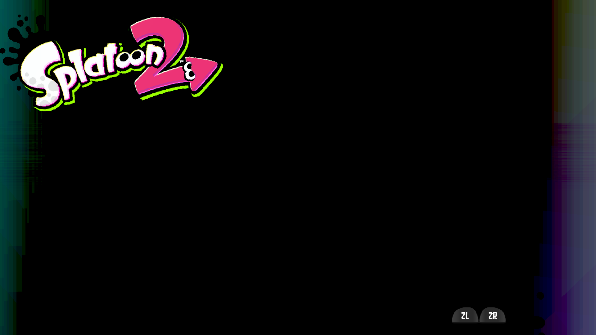
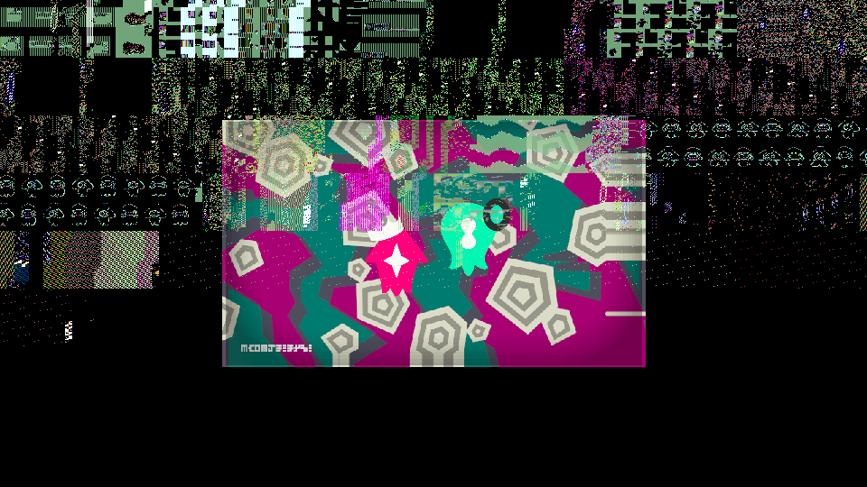
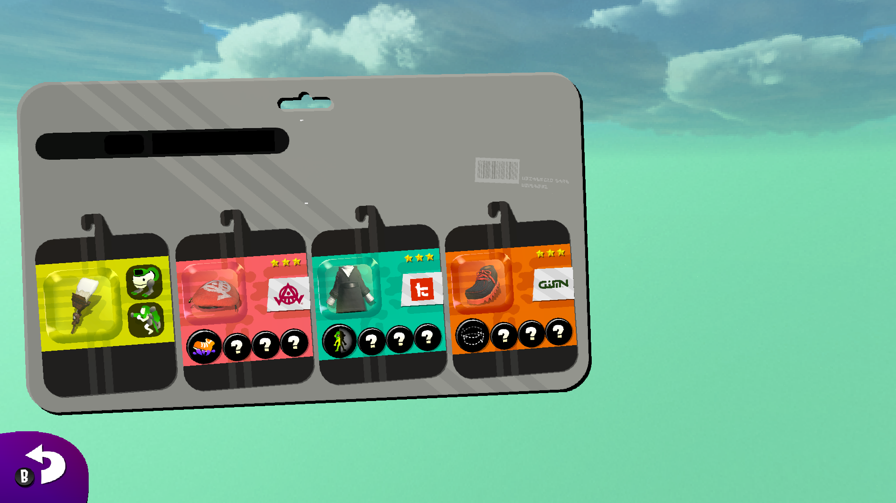
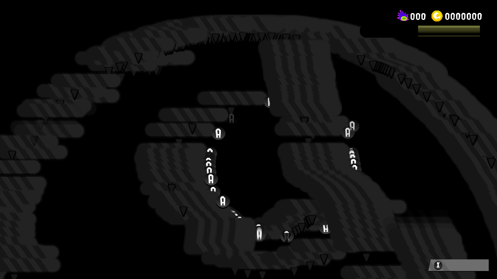
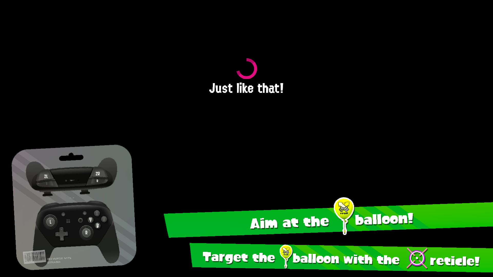
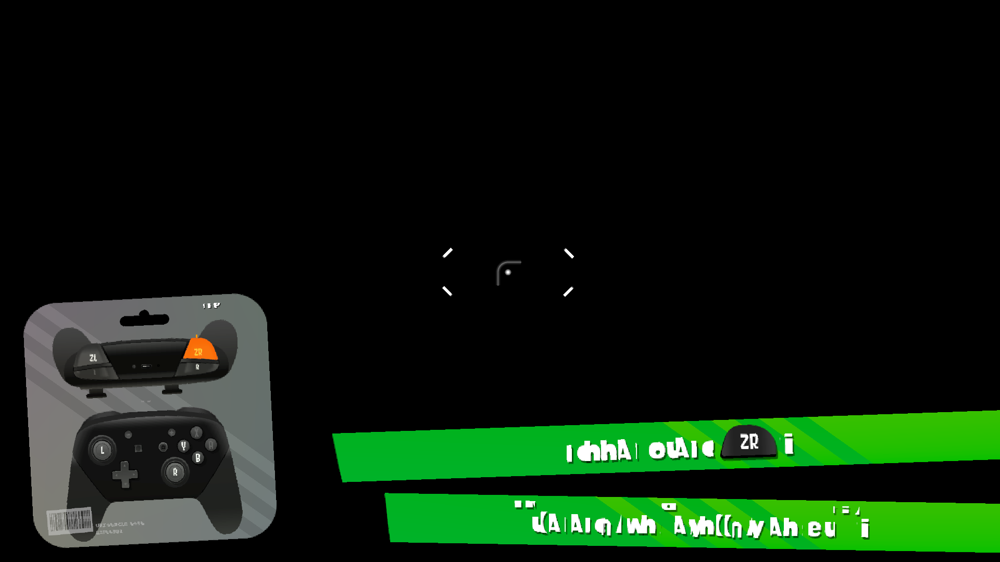
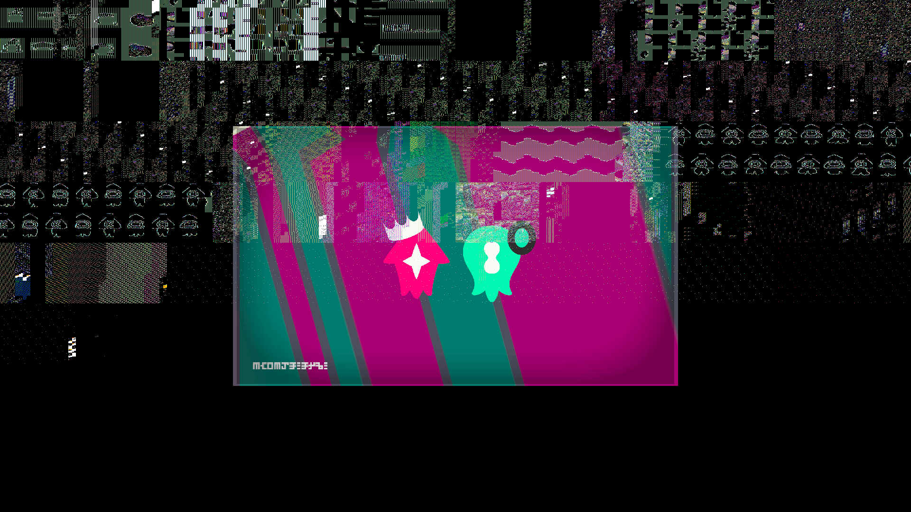
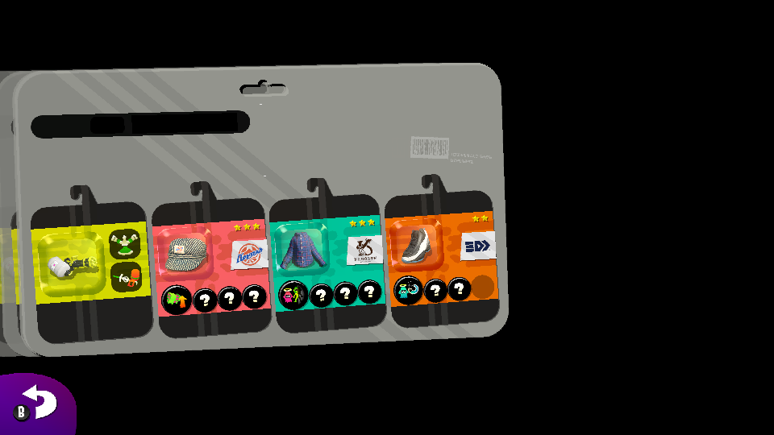

# sp2decomp

**English** · [Tiếng Việt](README_vi.md)

Reverse-engineering research notes and tooling for the Nintendo Switch executable
`main` of **Splatoon 2** (USA), whose ExeFS lives in the `Splatoon 2 USA.xci` dump,
plus a recompiled PC port of that executable.

This is a research log, not a finished decompilation. It records what has been
established about the module's structure, architecture and subsystems, the scripts
used to establish it, and how far the port has got.

## Current state

The recompiled port runs the game's own code on Vulkan on Windows. The title screen renders at
1920×1080. PlayerMake character creation completes with legible text, the intro cutscene plays,
and the first-launch controller tutorial runs: the controller page renders whole (the Pro
Controller diagram, the Joy-Con photo, the banner shapes, the button prompts), the guide
sentences read correctly, and the aim and ZR steps pass. The tutorial then reaches the Move page:
its controller diagram, "Move with L!" banner and hand prompt render, and the 3D room behind them
now renders too — a central 960×540 viewport, measured at ~98% non-black pixels and luma 85. A
temporary `SCENECHG` log in `main_00620ED0` makes the tutorial and UI/page state sequences
visible. Motion aiming reads a swept six-axis state (`NX_SIXAXIS_WOBBLE=1`), and a scripted input
sweep walks the steps forward.

The 9-state tutorial manager requests `5 → 6` after the first warp; an idempotent patch
redirects that one request to warp state 7. The 21-state UI/page manager's `4 → 5` request is
not a null-state dead end. Its state-5 entry stays null in the old table, but the page's virtual
scene-change handler constructs a new page manager and loads the title's Off the Hook news
scene. A live capture of the actual `4 → 5` transition is below: the central 960×540 TV
viewport shows the news studio and the two hosts, Pearl and Marina. The earlier `4 → 7` redirect
is a diagnostic detour that skips the news: it reaches the PlayerMake gear-selection screen
(`7 → 1 → 2 → 9`), whose state-9 entry is null, and stalls there.

The news now ends, and the plaza loads behind it. The news' own BGM handover is driven through
the game's code path by [patch-newsend-bgm-handover.py](tools/patches/patch-newsend-bgm-handover.py),
so the pose sequence completes and the scene goes `5 → 7 → 1 → 2`: the Turbun Shell reward, then
`SeqMgrPlaza::stateProgress`, i.e. Inkopolis Square. The last story transition is
`Cmn::BgmConductor::xlinkCalc`, the plaza's own track restarting. The 3D world behind the plaza UI
still does not draw (see [The plaza](#the-plaza)), so the square is only visible through the
first NPC page's camera. About one boot in three stalls in the UI job manager at the
character→tutorial transition (see Open).



*The title screen, rendered at the full 1920×1080 output size. The title appears around frame
6750 on this build; the route keeps the `ZL+ZR` chord held past that point.*



*The actual `4 → 5` UI/page transition loads the title's Off the Hook news scene. The central
960×540 viewport shows the news studio with Pearl and Marina; the old 21-state table still
reports its state-5 entry as null because the transition creates a new page manager. The
surrounding UI is still mis-scaled (the separate UI-layout issue), but the news scene itself
renders. The `4 → 7` detour skips this scene and reaches the gear-selection screen instead.*



*The plaza after the news: `5 → 7 → 1 → 2` reaches `SeqMgrPlaza::stateProgress` and the HUD
(level, cash, coins) comes up. The first NPC the route walks into opens the gear page
(`stateShowGearNpc`: weapon, headgear, clothes, shoes), and that page's camera renders the
square's sky behind it — clouds over a haze, in the lower-right area next to the card. The
lower two thirds of the frame are 100% non-black with 63–77 distinct colours per sampled
region, which is a rendered sky, not a flat fill. The `B` prompt backs out of the page.*



*The same plaza at rest, in `cProgress` with the NPC page closed and the camera turned: the
NPC/action markers and the HUD draw, but no stage geometry and no sky (98% of pixels black).
This is the current rendering blocker, described under "The plaza" below.*



*The aim step. The guide bands read "Aim at the [balloon] balloon!" and "Target the [balloon]
balloon with the [reticle] reticle!"; `Just like that!` is the game's answer once the swept
six-axis state brings the reticle onto the balloon. The bands are drawn by
`TutorialGuideMsgPage` with the CPU-written size-100 BlitzBold glyph atlas, which the port now
re-uploads when its bytes change.*



*The next step: "Shoot with [ZR]!" with "Tilt the controller to aim!" underneath; the Joy-Con's
ZR is lit orange and the prompt badge reads ZR.*



*The Move page. The Pro Controller diagram highlights the left stick, and the "Move with L!"
banner and hand prompt are drawn; the room behind them is now rendered as a central 960×540
viewport (~98% non-black, luma 85), rather than black. The page is a timed step:
`main_00A00BDC` advances the tutorial manager from page 6 to page 8 when the global counter
`[+0x44c]` reaches `0x12c0`, about 3,100 frames after the page starts. An earlier forced skip
took the `main_00A00300` actor-flag path at `L_A00350`, which calls `main_00620ED0(this, 7)` —
the quit-to-title path; the `SCENECHG` log showed `6 -> 7` and the title reappeared. The skip is
now disabled ([tools/patches/patch-move-skip-disable.py](tools/patches/patch-move-skip-disable.py)),
so the timeline transition runs.*



*The state-9 evidence frame from the first full planted-route run: the PlayerMake gear-selection
screen (four gear cards on the Switch tablet), reached through `4 -> 7 -> 1 -> 2 -> 9`. This is not
the plaza. State 9's entry is null, so the UI stops here; the image confirms that redirecting the
missing shot state to state 7 is a detour into the PlayerMake UI, not the plaza handoff.*


*PlayerMake, eye colour step ("Pick an eye color!"). Text is legible because the port stores the
CPU-written R8 glyph atlas as packed rows instead of untiling it. The two Inkling models are
still missing from the colour pass.*


*The confirmation page, captured before the language fix (`この設定でオッケー？`); the small
bottom-left hint is still garbled — a second, smaller atlas.*

Six fixes took the port from a boot fatal to this point:

- **Dropped tail call.** `Cui::Page::findPartsControl` (`0x20BD74`) ends in
  `b 0x20CF60`, a tail call into `Control::List::searchAs<PartsCtrl>`. The recompiler emitted
  the two instructions before it and no call, so the function returned
  `page->controls + 0x38` — a list pointer — to callers that expect a `PartsCtrl*`;
  `Cui::CustomizePartsSet::onInitialize` then called `(*ctrl)[0]` through it and died with
  `call to 50c12201b8` (heap) at boot. A scan of every generated function in every module for a
  final `b` to another function with no emitted call found **this as the only case in the whole
  game**. Patch: [tools/patches/patch-tailcall-20bd74.py](tools/patches/patch-tailcall-20bd74.py).
- **The glyph atlas is CPU-written.** The 2048×2048 R8 atlas is created with `stride 0` (the
  builder treats it as tiled), swizzle (R,1,1,1) and `alpha_from_r`, but the game fills it from
  the CPU, so its guest memory is packed `width`-byte rows. Untiling it produced streak noise
  (the `NX_DUMP_ALPHA` dump of the uploaded atlas showed no glyph shapes); treating stride 0 as
  `row_stride = width` and widening R8 → RGBA8 `(255,255,255,R)` made the labels legible.
  Patch: [tools/patches/patch-alpha-atlas.py](tools/patches/patch-alpha-atlas.py).
- **The glyph atlas was uploaded only once.** The size-100 BlitzBold atlas is also written by the
  CPU through mapped memory, but the font engine never reports that range to
  `nvnMemoryPoolFlushMappedRange` (the 32 KB+ flushes the port sees belong to other pools), so the
  image kept the letters of whatever face or size had filled those cells first — clean glyphs,
  wrong text. The port hashes one sampled byte in 61 of each sampled R8-read-as-alpha image once a
  frame and re-uploads the whole image when the hash changes; the tutorial's guide sentences now
  read correctly and the upload cost is paid only on the frames the font engine rasterises glyphs
  (`NX_ATLAS_REFRESH=0` disables). Patch: [tools/patches/patch-atlas-refresh.py](tools/patches/patch-atlas-refresh.py).
- **The reported language was byte-swapped.** `nn::settings::LanguageCode` is a `char[8]`,
  but the port wrote each tag as a number with its first character in the high byte, so
  `"en-US"` landed in memory as `"SU-ne"`. The game matched no language and fell back to
  Japanese (`/Message/CommonMsg_JPja.szs`), even though `nn::oe::GetDesiredLanguage` already
  answered `en-US` (that path `memcpy`s the tag). The codes are now derived from their string
  literals at compile time and the game loads `/Message/CommonMsg_USen.szs`.
  Patch: [tools/patches/patch-language-code.py](tools/patches/patch-language-code.py).
- **A null font face on the intro→title transition.** `nn::font::FSS_set_scale` checks the
  face pointer, calls `get_scale_inputs` (which can release and rebuild the face) and then
  reloads the pointer and reads `[face+0x20]` without checking it again. When the face is null
  at that point the game died at data address `0x20`. The patch honours FSS's own null-face
  error (`0x131`) instead, so the caller falls back to the unscaled glyph instead of crashing.
  Patch: [tools/patches/patch-fss-null-face.py](tools/patches/patch-fss-null-face.py).
- **Whole-target clears erased UI panels.** NVN clips a clear to the bound scissor. The port
  ignored the scissor (behind `NX_CLEARS_SCISSOR=1`) and cleared the whole attachment instead, so
  a clear meant for one UI panel wiped the rest of the UI image. On the first-launch tutorial
  this removed the Pro Controller diagram and other layout parts, leaving only the photo, banners
  and arrows. Honouring the scissor by default restores the whole page. `NX_CLEARS_SCISSOR=0`
  restores the old behaviour for bisecting (the port once saw a course break with scissored
  clears, docs/nvn/DEBUG.md #52).
  Patch: [tools/patches/patch-clears-scissor-default.py](tools/patches/patch-clears-scissor-default.py).

### The plaza

After the news, `SeqMgrPlaza` runs `5 cNews → 7 cGetTurbunShell → 1 cPreProgress → 2 cProgress`.
The Turbun Shell reward is the pop-up at frames 10000–15000 of the plaza run; `cProgress` is
Inkopolis Square, HUD up, with NPC/action markers on screen. The state names are the
string table at `main.bin+0x282e0d9` (`cReady, cPreProgress, cProgress, cFirstDemo, cTitle,
cNews, cIntro, cGetTurbunShell, cFirstTurbunShell, cNpc, …`), and the delegate table is at
`main.bin+0x2fbb578`.

One thing in the square does render, which is useful for separating what works from what does
not. Standing in front of an NPC and pressing `A` calls `SeqMgrPlaza::requestLookAtNpc`(`0x97CC2C`) → `changeStateTo(9)` = `cNpc`; that spawns `Game::SeqPlazaNpc` and opens
`stateShowGearNpc` (`main_00988E6C`). Inside that page the stage's sky draws behind the gear
card: fully populated, saturated clouds over a haze (100% non-black, 63–77 distinct colours per
sampled region). `B` there calls `changeStateTo(1, true)` into `stateShowStatusNpc`, whose back
button calls `outGearOrder` and returns `SeqMgrPlaza` to `cProgress`. With the page closed the
square is black again, while the `Lp::UI` markers and the HUD still draw (98% of pixels black).

The difference is not the route and not the moment the page closed. Entering `cProgress` and
never opening an NPC page leaves the square black; opening one, closing it with `B` and turning
the camera leaves it black as well — the same frames are byte-identical whichever way
`cProgress` is reached (frames 37500 and 42500 of the `plazab` run). The page camera is what
gives the stage's draws a usable state.

What the log rules out:

- **Missing NVN commands.** None of the stage draws need one. The runtime rejects nothing in
  this run (`0 unknown` submits, `nvnCommandBufferSetAlphaRef` is the newest command the game
  first calls, and every other unimplemented NVN call — indirect draws, buffer copies,
  transform feedback, debug groups — is never made).- **Missing pipelines.** The 60-frame report shows `0 no pipeline` throughout; the stage's 637
  pipelines and 13 ASTC textures are built right after `2 → 9` (3.5 s of compile). Draws that
  reach the replay without a *program* do not draw: `no program` goes from 0 to ~3–5 million
  over the run, and the 512-entry pipeline cache thrashes from the title onward. This is a
  consequence of the cache cap, not a missing shader.
- **The viewport's clears.** The last clear statistics show `96812 scissored`, of which only 13
  left their pass and cleared a whole target — the plaza's clears are scissored to the
  960×540 composite viewport, so the square's own pass is not being wiped from outside.

So the open question is inside the stage pass itself. The next step is a pass trace of one
plaza frame (`NX_TRACE_PASSES_FROM_FRAME`, [patch-pass-frame.py](tools/patches/patch-pass-frame.py)):
which target the stage draws into, whether the pass is created there at all, and whether its
draws arrive after the composite viewport has been blitted.

### Memory, input and the tutorial

- **Six-axis sensor HLE.** `GetSixAxisSensorHandles` used to leave the output untouched, and it
  returned 0 where the API returns the number of handles written. `sead::NinJoyNpadDevice::calc`
  stores that value as its sensor count, so the game concluded the controller had no sensor and
  never called `StartSixAxisSensor` or `GetSixAxisSensorStates`. With the count returned, the game
  starts sensor 0 and reads 16 states every frame; the HLE reports a controller held level
  (identity direction, gravity on -Z, 1/60 s delta). `NX_SIXAXIS_WOBBLE=1`
  ([patch-sixaxis-wobble.py](tools/patches/patch-sixaxis-wobble.py)) adds a slow pitch/yaw sweep
  for the tutorial's "Tilt the controller to aim!" step. Patch:
  [tools/patches/patch-sixaxis.py](tools/patches/patch-sixaxis.py).
- **R11G11B10F stored natively.** NVN format `0x3f` was always widened to RGBA16F off Android,
  doubling every HDR load/store/sample (636 MB of 1020 MB live images at the title on a 6 GB
  laptop GPU, and it ran out of device memory at the tutorial). The port now uses
  `B10G11R11_UFLOAT_PACK32` when the device can render, blend, filter and copy it, halving
  those images (`NX_R11G11B10_EMULATE=1` restores the old behaviour). At the tutorial the live
  set went from 5.6 GB to 1.2-1.7 GB with no failed allocations. Patch:
  [tools/patches/patch-r11-native.py](tools/patches/patch-r11-native.py).
- **Image accounting.** A live `VkDeviceMemory` histogram by NVN format is logged with the
  60-frame report, which is how the R11G11B10F and D32F sets were sized. Patch:
  [tools/patches/patch-imgstats.py](tools/patches/patch-imgstats.py).
- **Pipelines.** The pipeline cache is capped (`NX_PIPE_CAP`, default 2048) with deferred
  destruction; the tutorial's UI reaches about 2100 live pipelines, so the cap is a band-aid
  rather than a fix, and pipeline memory is a large part of the 6 GB budget.

Open:

- **The plaza's 3D world.** `SeqMgrPlaza::stateProgress` runs, the HUD and markers draw, and the
  stage's pipelines and textures build, but the square's own geometry and sky leave no pixels at
  rest — only the NPC gear page's camera renders the stage sky (see "The plaza"). First suspect:
  the stage pass itself, since the composite's scissored clears only cover the 960×540 viewport,
  and the pipeline cache thrash (512 cap, 3–5 million `no program` draws) is what makes the
  replay drop draws.
- **UI job stall at the character→tutorial transition.** About one boot in three the game stops
  advancing at frame ~2933–2942 with no render thread activity: the main thread waits in
  `Lp::UI::Impl::JobMgr::endRun` on a light event while a UI job worker is still inside
  `nn::font::TextureCache::CalculateKerning` → `FSS_set_scale`, so the job never completes.
  Re-running the same script usually passes. The stack is in the font code path whose atlas is
  handled by the atlas-refresh fix above, so the face/glyph-cache handling is the first suspect.
- **Font layout loop.** A `FSS_set_scale` layout can keep the UI job worker inside the glyph
  loop for minutes. The temporary 512-glyph cap
  ([tools/patches/patch-fss-loop-cap.py](tools/patches/patch-fss-loop-cap.py)) returns `0x131`
  after the cap, which keeps the job manager alive; the face removal and atlas handling are the
  real fix and remain open.
- **Characters.** Submitted every frame as fully skinned draws with real model textures, and
  the mask pass rasterises them (verified by target snapshots), but the visible colour pass
  leaves no pixels.
- **Device memory.** On the 6 GB laptop GPU the load still briefly peaks above the R11G11B10F
  savings: several runs log `vkAllocateMemory failed (-2)` around the character customisation
  load (live images 2.6 GB at frame 233) and either recover or stall. The live set fell to
  1.2–1.7 GB once the tutorial is up, so the peak, not the steady state, is the problem.
- **Loading is slow.** The "now loading" screen with the ink spinner runs at 0.8–6 fps because
  the game's own texture registration and decompression work runs as recompiled guest code;
  once loading finishes the title screen runs at 33–58 fps.

## Start here

| What you want | Where to go |
|---|---|
| What is known, what is not, and in what order to read | [STATUS.md](STATUS.md) |
| How far the port gets on screen right now | [RECOMP_BOOT_TO_UI.md](RECOMP_BOOT_TO_UI.md) |
| The decoded startup chain | [BOOT_CALLGRAPH.md](BOOT_CALLGRAPH.md) |
| The whole `main` module in one document | [ENGINE_REFERENCE.md](ENGINE_REFERENCE.md) |

### Porting

- Scope and target: [PORTING.md](PORTING.md), [BOOT_MILESTONE.md](BOOT_MILESTONE.md), [BOOT_ENGINE_ORDER.md](BOOT_ENGINE_ORDER.md)
- Worklist and platform contract: [PORT_WORKLIST.md](PORT_WORKLIST.md), [PLATFORM_IMPLEMENTATION_SPEC.md](PLATFORM_IMPLEMENTATION_SPEC.md), [PLATFORM_REFERENCE.md](PLATFORM_REFERENCE.md)
- Where the platform layer lives: [PLATFORM_LAYER_LOCATION.md](PLATFORM_LAYER_LOCATION.md)
- Graphics path: [GRAPHICS_NVN.md](GRAPHICS_NVN.md), [GRAPHICS_SCOPE.md](GRAPHICS_SCOPE.md)

### Background and coverage

- Engine and middleware: [ENGINE_RECONSTRUCTION.md](ENGINE_RECONSTRUCTION.md), [SEAD_COVERAGE.md](SEAD_COVERAGE.md), [NNWARE_COVERAGE.md](NNWARE_COVERAGE.md), [AGL_COVERAGE.md](AGL_COVERAGE.md)
- `sdk` module: [SDK_ANALYSIS.md](SDK_ANALYSIS.md), [SDK_REFERENCE.md](SDK_REFERENCE.md)
- Layout verification: [VERIFICATION.md](VERIFICATION.md), [VTABLE_VERIFICATION.md](VTABLE_VERIFICATION.md)
- Tooling and decompilation route: [DECOMPILATION_UNBLOCKED.md](DECOMPILATION_UNBLOCKED.md), [DECOMPILED_BODIES.md](DECOMPILED_BODIES.md)
- Wider ecosystem survey: [ECOSYSTEM.md](ECOSYSTEM.md), [subsystem-map.txt](subsystem-map.txt)

## In this document

[Status](#status) · [Target](#target) · [NSO container layout](#nso-container-layout) ·
[Architecture observations](#architecture-observations) · [Memory map](#memory-map) ·
[Subsystem decomposition](#subsystem-decomposition) · [Content pipeline](#content-pipeline) ·
[Toolchain](#toolchain) · [Reproduction](#reproduction) · [Limitations](#limitations) ·
[Legal](#legal) · [License](#license)

---

## Status

| Area | State |
|---|---|
| Target identification | Done |
| Container/format handling | Done |
| Memory map | Done |
| Function/symbol inventory | Done (113,150 functions) |
| Subsystem decomposition | Done (55 namespaces) |
| Engine & middleware identification | Done |
| **Function-body decompilation** | **Not done** — see [Limitations](#limitations) |
| **Recompiled PC port** | Boots to the in-game UI: `RootTask::prepare_`, display loop, PlayerMake character creation, the title screen at 1920×1080, and the first-launch tutorial - [RECOMP_BOOT_TO_UI.md](RECOMP_BOOT_TO_UI.md). The tutorial advances past aim/ZR with legible guide text, and the Move page's central 960×540 3D room renders. The tutorial→plaza boundary is under test: an idempotent patch redirects the tutorial's `5 → 6` to warp state 7, and the 21-state UI/page manager's real `4 → 5` handoff loads the Off the Hook news scene (the old table's state-5 entry is null because the transition creates a new page manager). The earlier `4 → 7` detour reached the gear-selection screen and stalled at null state 9; it is a diagnostic, not the plaza path. The 3D plaza is still unconfirmed; the news scene and its two hosts render in the central 960×540 viewport. About one boot in three stalls at the character→tutorial UI job transition. |

Everything below is static analysis of the shipped binary unless a section says
otherwise; runtime findings from the port are labelled as such. Behaviour is only
claimed where it has been observed or decompiled.

---

## Target

| Property | Value |
|---|---|
| Module | `exefs/main` (23,717,627 bytes) |
| Container | **NSO0** (not an ELF on disk) |
| Architecture | AArch64, 64-bit little-endian |
| Title ID | `01003bc0000a0000` |
| ACID | `Is Retail: 1` |
| Build ID | `F18FF3CFCBAD0884D72ABBEB6C540D6B00000000000000000000000000000000` |
| Main thread stack | `0x100000` |
| Main thread priority | 44 (ACID allowed range 28–59) |
| ExeFS siblings | `main.npdm`, `rtld`, `sdk`, `subsdk0`–`subsdk3` |
| Image base (as loaded) | `0x7100000000` |

### Confirmation that this is Splatoon 2

Resource names recovered from `.rodata` are conclusive:

```
WeaponInfo_%s.byml      GearInfo_%s.byml        UdemaeGrade.byml
TankInfo.byml           SkillInfo.byml          BrandInfo.byml
BottomInfo.byml         HairInfo.byml           PaintResTex.byml
PlayerRank.byml         EnemyInfo.byml          DamageRateInfo.byml
MapInfo.byml            NpcInfo.byml            ActorDb.byml
WorldHotaruTalkInfo.byml                        WorldHotaruFreeTalkInfo.byml
```

The map that shipped as **MakoMart** carries the internal codename **Blitz** —
`Map/Blitz.mutre.szs` — independently corroborated by a `BlitzViewer` symbol
namespace in the binary.

---

## NSO container layout

`main` is an NSO0 container: the sections are LZ4-compressed and packed
back-to-back on disk, but each section's *memory* offset is page-aligned. That
gap is the single most important detail when reconstructing the image.

| Section | Memory range | Size |
|---|---|---|
| `.text` | `0x0000000` – `0x1415068` | 21,045,608 |
| `.rodata` | `0x1416000` – `0x2d624b3` | 26,526,899 |
| `.rwdata` | `0x2d63000` – `0x2fdb1b0` | 2,589,104 |
| `.bss` | `0x2fdc000` – `0x3699e50` | 7,065,504 |

### MOD0

The module header `MOD0` sits at **`.text+0x8`**. Per the
[SwitchBrew MOD specification](https://switchbrew.org/wiki/MOD) it is a
replacement for `PT_DYNAMIC` and **contains no entry point**:

| Offset | Field | This build |
|---|---|---|
| 0x0 | Signature `"MOD0"` | `4d4f4430` |
| 0x4 | `DynamicOffset` | `0x2f9a468` |
| 0x8 | `BssStartOffset` | `0x2fdbff8` |
| 0xC | `BssEndOffset` | `0x3698f98` |
| 0x10 | `ExceptionInfoStartOffset` | `0x2921ec0` |
| 0x14 | `ExceptionInfoEndOffset` | `0x2a00eac` |
| 0x18 | `ModuleOffset` (runtime-generated, ≈ `.bss` base) | `0x2fdbff8` |

> **Correction.** An earlier revision of this README derived an "entry VA" from
> `entryTarget + entryOffset` using offsets `0x10`/`0x14`. Those fields are
> exception-handling metadata. There is no entry point in MOD0; the module is
> entered through the dynamic section. See
> [BOOT_MILESTONE.md](BOOT_MILESTONE.md) for the real boot chain.

The dynamic section (VA `0x2f9a470`) carries the boot-relevant pointers:

```
DT_INIT          = 0x24
DT_FINI          = 0x160
DT_INIT_ARRAY    = 0x2fd7f90      1604 static constructors
DT_INIT_ARRAYSZ  = 0x3220
```

### A note on a NSO header field

The 32-bit field at NSO header offset `0x40` is **reserved**. It is not a `.bss`
address, and it must not be read as one — in this container it holds the `.data`
section's compressed size. Treating it as an address produces a `.bss` that
overlaps `.rwdata`. `.bss` follows the last initialised section in memory.

---

## Architecture observations

`.text` holds 5,264,410 instructions. Instruction census:

| Encoding | Count | Meaning |
|---|---|---|
| `STP x29,x30,[sp,#-N]!` | 7,316 | function prologues (lower bound on functions) |
| `STP x29,x30,[sp,#N]` | 60,453 | saved-frame stores |
| `B` (`0x14......`) | 114,236 | unconditional branches |
| `PACIBSP` / `AUTIBSP` | **0** | no pointer authentication |
| `BTI c` | **0** | no branch target identification |

The first instruction at VA `0x100` is `stp x29,x30,[sp,#-0x10]!`, a textbook
prologue confirming `.text` begins with code.

> **Inference.** Pointer authentication and BTI are the mitigations introduced by
> Nintendo's later SDKs. Their complete absence is consistent with a build from
> the 2017 launch-era toolchain. This is an inference from instruction absence,
> not a build-string observation.

---

## Memory map

As reconstructed by an analysis load of the module (18 blocks):

```
.text          7100000000   21,045,608  r-x
.plt           7101412168       12,032  r-x
.rodata        7101416000           72  r--
.rela.dyn      7101416048    6,121,056  r--   dynamic relocations
.rela.plt      71019ec6a8       18,048  r--
.hash          71019f0d28    1,110,904  r--
.gnu.hash      7101b000a0    1,238,848  r--
.dynsym        7101c2e7e0    3,518,952  r--   148,138 symbols
.dynstr        7101f899c8    8,828,579  r--   8.8 MB of names
.rodata.1      71027f506b    5,690,440  r--
.data          7102d63000    2,323,568  rw-
.dynamic       7102f9a470          400  rw-
.data.1        7102f9a600           80  rw-
.got.plt       7102f9a650        6,040  rw-
.got           7102f9bde8      246,184  rw-
.init_array    7102fd7f90       12,832  rw-
.bss           7102fdc000    7,065,504  rw-
```

**The module is not stripped.** The embedded ELF dynamic symbol table survives:
3.5 MB of `.dynsym` and 8.8 MB of `.dynstr`. This is the single most valuable
property of this target — analysis starts from 113,150 real function names rather
than `FUN_xxxxxxxx`.

---

## Subsystem decomposition

113,150 functions across 55 top-level namespaces.

| Namespace | Functions | Interpretation |
|---|---:|---|
| `Game` | 28,439 | core gameplay |
| `nn` | 15,953 | NintendoSDK |
| `Lp` | 10,672 | game framework layer |
| `Cmn` | 4,447 | shared game code |
| `sead` | 4,022 | first-party C++ library |
| `agl` | 2,852 | graphics |
| `aal` | 2,264 | SDK applet/UI |
| `gsys` | 2,099 | game system layer |
| `Cui` | 1,815 | SDK UI components |
| `eui` | 803 | SDK extended UI |
| `Lobby` | 792 | online lobby |
| `enl` | 717 | — |
| `Cnet` | 590 | network |
| `Match` | 555 | matchmaking |
| `xlink2` | 548 | audio/effect middleware |
| `Shop` | 509 | in-game shop |
| `pead` | 490 | sound |
| `UICheck` | 413 | UI validation |
| `MiniGame` | 184 | — |
| `PlayerMake` | 132 | character creation |
| `Cstm` | 121 | customization |
| `DbgSetting` | 120 | debug settings |
| `PlayerViewer` | 86 | debug viewer |

Plus 33,692 `_Z`-mangled functions (operators, thunks, templates) and 327 plain-C
functions.

### Internal tooling present in the retail build

Debug and test harnesses survive in the shipping binary:

```
DbgSetting 120   PlayerViewer 86   UdgwTest 66      NisdTest 33
EnemyObjViewer 28   ScheduleViewer 27   YmgcTest 25   JintTest 21
GearUnsetupTest 20  BlitzViewer 9   GndColTest 7      MrmtTest 3
```

### Engine and middleware

| Component | Evidence |
|---|---|
| **sead** | `sead::CalculateTask` (calculate/draw task graph), `ExpHeap`, `CriticalSection`, `SafeStringBase`, `Matrix34f`, `TreeNode`, `Path::getExt` |
| **agl** | 2,852 functions, 6,024 `.rodata` hits |
| **Radiance** | `Etc/BRDFFitting/ggx_ltc.byml` (GGX LTC BRDF fitting) |
| **NintendoWare / Nw4f** | 35 `.rodata` hits |
| `nn::nex` | Nintendo networking |
| `nn::bcat` | DeliveryCache (background content delivery) |
| `nn::aoc` | add-on content |
| `nn::nfp` | Amiibo (`Cmn::Def::isSupportedAmiibo`) |
| libcurl | 24 functions / 36 symbols — HTTP |
| **wslay** | 53 functions — WebSocket |
| zlib | 49 functions / 63 symbols |
| libc++ (`std::__1`) | 292 functions |
| `__nnmusl` | Nintendo's musl-derived libc |

The libcurl + wslay + `Cnet`/`Match`/`Lobby`/`Shop` combination is consistent with
a live-service architecture.

---

## Content pipeline

Resource paths recovered from `.rodata`:

```
Model/%s.Nin_NX_NVN.szs      NX NVN (NVIDIA) model container
Map/%s.szs                   Map/Blitz.mutre.szs
Env/%s.szs                   Etc/LightCtrl/%s.byml
Nin_NX_NVN.release.szs       Etc/BRDFFitting/ggx_ltc.byml
HapTexture.bfres             PanelTexture.bfres        IconTexture.bfres
```

One string leaks the internal build toolchain:

```
File = %%AGL_ROOT%%/tools/bat/convertTempTexture.bat, NoWindow = True,
WindowStyle = Hidden, WaitEnd = True, Arg = %%AGL_ROOT%%/tools/temporary/temp_proj_light.bfres
```

`.mutre` is a distinct map variant format from `.szs`.

---

## Toolchain

### Prerequisites

- **Ghidra 12.1.2** (the extension below matches this version)
- **JDK 21+** — `JAVA_HOME` must point at the JDK root
- **[SwitchLoader](https://github.com/Adubbz/Ghidra-Switch-Loader)** — Ghidra
  loader for Nintendo Switch formats. Provides both NSO loading and the ELF
  `.dynsym` recovery used here.
- **hactool** — to extract the ExeFS from the XCI and decompress NSO sections
- **Node.js 18+** for the scripts in `tools/`
- **Python 3** via Ghidra's PyGhidra if you want the scripted inventory export

### Environment

```powershell
$env:GHIDRA_INSTALL_DIR = 'C:\path\to\ghidra_12.1.2_PUBLIC'
$env:JAVA_HOME          = 'C:\Program Files\Java\jdk-21.0.12'
```

Install SwitchLoader through Ghidra's *File → Install Extensions…*, then restart
Ghidra. Do not place the same extension in both the Ghidra install and the user
extension directory — Ghidra aborts with
`Multiple modules collided with same name`.

### Extract the target

```powershell
hactool -t xci --exefsdir=exefs "Splatoon 2 USA.xci"
hactool -t nso exefs/main --uncompressed=main.decompressed
```

Keys are required for the XCI but **are not part of this repository** and must
never be committed.

---

## Reproduction

### 1. Export the symbol inventory

PyGhidra must be started explicitly, otherwise Python scripts fail with
*"Ghidra was not started with PyGhidra"*:

```powershell
& "$env:GHIDRA_INSTALL_DIR\support\pyghidraRun.bat" -H `
    "<project-dir>" Sp2 `
    -import "exefs\main" `
    -noanalysis `
    -scriptPath "<repo>\tools\ghidra" `
    -postScript ExportInventory.py "<repo>\inventory.txt" `
    -deleteProject
```

Expected:

```
ExportInventory wrote inventory.txt (functions=113150 symbols=148138 strings=146621)
```

An import-only pass (`-noanalysis`) is deliberate: the ELF symbol table gives the
function names without paying for analysis. Function *sizes* from this pass are
placeholders and must not be interpreted as code sizes.

### 2. Analyse the inventory

```bash
node tools/static/analyze-inventory.mjs inventory.txt
node tools/static/namespace-report.mjs   inventory.txt
node tools/static/subsystem-map.mjs      inventory.txt subsystem-map.txt
node tools/static/symbol-census.mjs      main.decompressed
node tools/static/check-prologue.mjs     main.decompressed
```

### 3. Container tooling

`tools/nso/nso2elf.mjs` rebuilds a loadable ELF64 from a decompressed NSO. It
exists for analysis engines without NSO support; Ghidra with SwitchLoader does
not need it.

```bash
node tools/nso/nso2elf.mjs main.decompressed main.elf
node tools/nso/validate-elf.mjs main.elf      # structural self-check
node tools/nso/mod0-exports.mjs main.decompressed
```

`validate-elf.mjs` checks the ELF header, the `p_vaddr ≡ p_offset (mod align)`
segment rule, segment/section overlap, and `.bss` placement. It was written after
four real layout bugs were found by hand.

---

## Limitations

These are genuine, unresolved gaps. Do not read the tables above as a complete
account of the binary.

1. **No function bodies were decompiled.** The inventory is symbol-level only.
   Consequently **no claim about runtime behaviour is made anywhere in this
   repository.**

2. **Full auto-analysis does not complete.** Ghidra's headless analyzer wedges
   reproducibly. 22 functions recurse through computed jumps whose targets fall
   outside the image; the log then advances only ~99 bytes per 3 minutes:

   ```
   WARN Decompiling 710090ab30: Unable to read bytes at ram:23504cd0fec
   ```

   This is the decompiler following a computed jump, not a defect in the
   reconstructed image. Running analysis in the **Ghidra GUI**, which can be
   driven incrementally, is the recommended way past it.

3. **REA cannot drive this target on Windows.** The REA 6.5.0 Ghidra adapter
   admits only x86/x86-64 PE and explicitly selected raw 6502 images:

   > "Windows Ghidra P0 accepts native x86 and x86-64 PE applications and DLLs,
   > and explicitly selected raw 6502 images"

   Both an ELF and a headerless `--architecture arm64` attempt are rejected with
   `target_format_unsupported`. Hopper is macOS-only and IDA was unregistered.
   The Ghidra installation itself does ship AArch64, so this is an adapter
   restriction, not a missing processor module.

4. **MOD0 export-table parsing is unresolved.** Two candidate field layouts gave
   contradictory results (one negative offset, one past EOF), so no function
   names in this repository are derived from the MOD0 table. The names come from
   the ELF `.dynsym` via SwitchLoader.

5. **Namespace attribution is by symbol prefix only.** A namespace label
   describes where a symbol is declared, not what the code does.

---

## Legal

This repository contains **no game code, no game data, and no cryptographic
keys** — only analysis notes and original tooling. Splatoon 2 and Nintendo
Switch are trademarks of Nintendo. No affiliation or endorsement is claimed.
Intended for interoperability research and preservation; use your own legally
obtained copy of the game.

## License

Original tooling and notes in this repository are released under the MIT License.
See [LICENSE](LICENSE).
