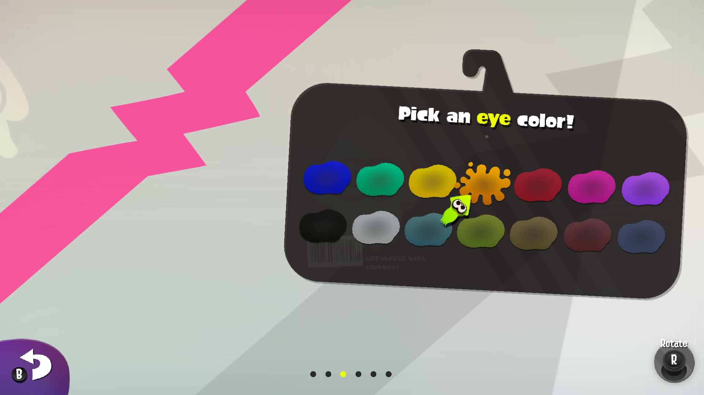
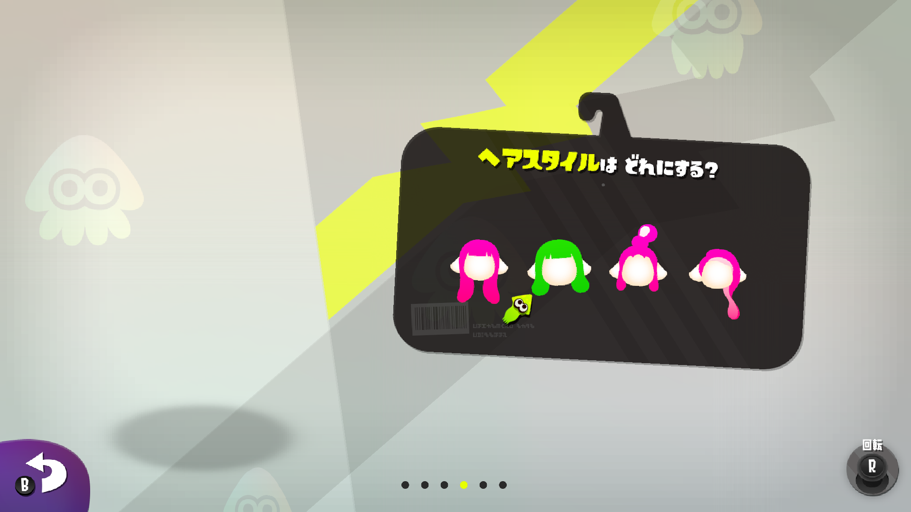
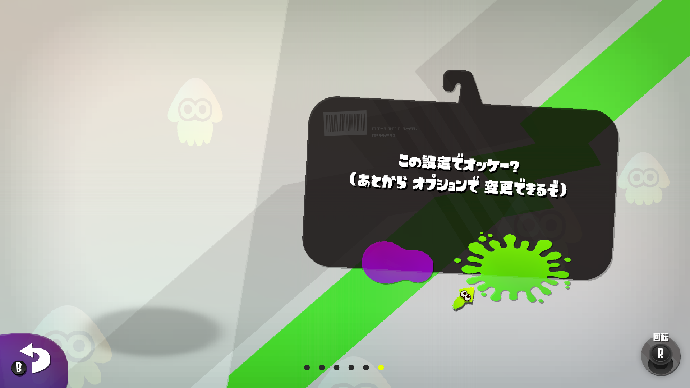

# Recompiled port — green boot: display loop and real frames

This is the state of the recompiled PC port (`~/sp2port`, runtime under
`runtime/src/`) as of 2026-10-20. It is a living log: each row of the ladder was
a real fatal, diagnosed from the guest's own stack and fixed in the runtime.

The port now enters `nnMain`, initialises NVN/sead graphics, HID, settings, the
SDK's own module init and audio, completes `RootTask::prepare_`, returns from
`sead::GameFramework::waitStartDisplayLoop_` and runs the display loop with
**real, non-black frames**: a 150 s run presents to `#1024` with the boot tip
carousel and the title screen on screen, no fatal, no validation error and no
unknown-handle call. The last two blockers were a BC3 texture bound as a render
target (host SIGFPE) and command lists dropped by the port's lifetime heuristic
(which made every frame black); both are described below. Section 10 adds a
native Windows build of the same sources, so the port also runs on the host GPU
(RTX 3060, 60 fps) instead of lavapipe.

## 2026-10-20: legible text, and the boot fatal explained

Three fixes moved the port from "boots but every label is a white blob, then a fatal in
PlayerMake" to a completed character-creation flow, the intro cutscene, and the post-intro
tutorial screen in English.

### The game spoke Japanese because the language code was byte-swapped

`nn::settings::LanguageCode` is a `char[8]`; the game compares the tag it gets back against
its own list of console languages. The port stored each tag as a *number* whose high byte is
the tag's first character (`0x656E2D5553` for `en-US`), and little-endian guest memory
therefore read `"SU-ne"`. No tag matched, so the game fell back to Japanese and opened
`/Message/CommonMsg_JPja.szs` — while `nn::oe::GetDesiredLanguage` (a `memcpy` of `"en-US"`
in `svc_am.cpp`) already answered correctly. With the codes derived from their literals at
compile time the game opens `/Message/CommonMsg_USen.szs` and every label is English
(`tools/patches/patch-language-code.py`).



*`Pick an eye color!` — the same screen after the language fix.*

### The boot fatal was a dropped tail call, not a vtable bug

Symptom:

```
FATAL: call to 50c12201b8 (50c12201b8), lr main+1d95d4
       (_ZN3Cui17CustomizePartsSet12onInitializeEPKv+a4)
```

`onInitialize` (`0x1D9530`) calls `Cui::Page::findPartsControl` (`0x20BD74`) for each of
`/L_ItemBtn_00..17`, then calls `(*ctrl)[0](ctrl, &expected_type)`. Runtime probes showed
the returned object was `page + 0x3f0 → +0x38` — the control **list**, not a control —
whose first word is a heap pointer, hence the "vtable" jump into the heap.

`findPartsControl` is three guest instructions:

```asm
ldr x8, [x0, #0x3f0]
add x0, x8, #0x38
b   0x20cf60        ; Control::List::searchAs<PartsCtrl>
```

The recompiler emitted the first two and **dropped the `b`**, so the function returned
the list pointer as if it were a found control. `searchAs` never ran, so its own type
check never rejected the object. Heap layout decided the failure mode: when the list's
first word happened to look like a callable address the port died; in other builds the
check returned false and every parts control was silently missing from the UI.

A scan of every generated function in every module (final guest instruction is an
unconditional `b` to another function, but the generated body has no call to it) finds
**this as the only case in the whole game**:

```bash
python3 tools/rework/find-dropped-tailcalls.py
# main: functions ending in b 20074, dropped 1
#    20BD74 .. b at 20BD7C -> 20CF60
```

The fix re-adds the call (`tools/patches/patch-tailcall-20bd74.py`); it is a tail call,
so not touching `x30` is correct — the emulated callee returns to the same guest caller.

### The glyph atlas is CPU-written: keep its rows packed

The font atlas is a 2048×2048 R8 texture with `stride 0` (builder: tiled), swizzle
`02010101` = (R,1,1,1) and `alpha_from_r`. Widening R8 → RGBA8 made text *appear* but
garbled; the `NX_DUMP_ALPHA` dump of the uploaded atlas (alpha shown as grey) was
horizontal streak noise — the untiled interpretation of memory that the game writes as
plain rows.

The CPU writes the atlas (nothing uploads it: no draw, copy or `nvnTextureWriteTexels`
targets the pool), so `stride 0` means "packed rows of `width` bytes" here, not tiling.
`row_stride = stride ? stride : width` plus the (255,255,255,R) widening makes every
label legible (`tools/patches/patch-alpha-atlas.py`).



*After both fixes: `ヘアスタイルは どれにする？` ("Which hairstyle?") is readable, and the
flow advances through the six PlayerMake steps.*



*`この設定でオッケー？` — the confirmation page. The small bottom-left hint still comes from a
second, smaller atlas that is not covered by this fix.*

Remaining, in order: the Inkling models are still absent from the colour pass; the first
screen after the intro lays out a text box at font size 100 and crashes in
`nn::font::TextureCache::CalculateCharWidth` → `FSS_set_scale` → `get_scale_inputs`
(data address `0x20`, the FSS face handed to the scaler is invalid), so the port does not
reach the title yet. (The earlier `TutorialGuideMsgPage` → `FSS_set_cmap` crash is the same
family: a font face the cache refers to is not a usable FSS face.)

## Running

```bash
cd ~/sp2port
VK_ICD_FILENAMES=/usr/share/vulkan/icd.d/lvp_icd.json NX_HEADLESS=1 ./sp2
# NX_TRACE=1      verbose (svc / HLE / IPC / NVN)
# NX_TRACE_FS=1   every file the game opens
# NX_DUMP_FRAMES=100  write private/frames/00100.ppm, 00200.ppm, ... from the presented texture
# NX_NO_KEEP_LISTS=1  restore the old command-list drop rule (frames go black, see below)
# NX_CV_HIST=1    record the last 4096 condition-variable events; a hang report prints the stuck keys' histories
```

A healthy run ends in exit 124 (the timeout), prints `nvn: present #N` throughout
and leaves no `fault report`, no `SIGSEGV`/`SIGFPE` and no `VUID` line.

For a quick look at the picture: `./shot.sh [seconds] [every]` (default 90 s,
every 100 frames) boots the port, prints the presents/fps/handles summary and
converts the fresh dumps to PNGs — `ppm2png.py` does the conversion alone, and
`shot.sh` also copies the PNGs to `C:\Users\Hexa\Documents\nintendo\frames\`.
The tip screen appears from roughly frame 300 on; before that (frames ~100-250)
the title screen covers the frame.

The game's romfs must be reachable: `private/extract/romfs` is a symlink to the
`romfs/` directory produced by hactool.

On the **host GPU** (no lavapipe): build `sp2.exe` with `./build-win.sh` in WSL
and run it on Windows — `tools/wsl/run-win.ps1` does the staging, the romfs
junction and a timed run (section 10):

```powershell
powershell -File tools\wsl\run-win.ps1 -Seconds 120        # -DumpEvery 0 for speed
```

Single-object rebuild + relink (the pattern used for every fix below):

```bash
cd ~/sp2port
g++ -std=c++20 -c -O1 -w -I runtime/include -I runtime/src -I ~/vkheaders/include \
    runtime/src/<file>.cpp -o obj-all/_runtime/<file>.o
GEN=$(find obj-all -name '*.o' | grep -v _runtime | tr '\n' ' ')
RTO=$(find obj-all/_runtime -name '*.o' | tr '\n' ' ')
g++ -o sp2.new $GEN $RTO -lm -lc -lgcc -lpthread -ldl && mv sp2.new sp2
```

## Boot ladder

Every entry is a fatal that was hit and fixed during this session, in order.

| # | Symptom | Cause | Fix |
|---|---------|-------|-----|
| 1 | SIGSEGV inside HLE `GetStorageSize` → `format_info()` (`module_base + 0xd34198 + fmt*0x30`) | port used the previous title's SDK format-table slot | `nvn/nvn_texture_layout.cpp`: this title's driver table — slot `subsdk0+0x17ebd0`, stride `0x34`, fields `+8`/`+9`/`+16` |
| 2 | `FATAL: call to 0` inside `nvnTextureInitialize` | port called `nvnTextureBuilderGetPackagedTextureLayout`, absent from this driver | `nvn/nvn.h`: `driver_or()` + `driver()` fatals naming the proc; `nvn/nvn_objects.cpp`: fall back to `nvnTextureBuilderGetPackagedTextureData` |
| 3 | `FATAL: nvn: this title's driver has no nvnWindowBuilderGetNumTextures` | this SDK's window-builder API differs | `nvn/nvn_queue.cpp`: read builder fields directly (`+8` count, `+0x10` texture array, `+0x20` interval−1) |
| 4 | SIGSEGV at 0 in `nn::hid::detail::SharedMemoryAccessor::Activate` | the `hid` IPC service was a bare stub: `CreateAppletResource` returned no object, so `[accessor+0x38]` stayed null | `hle_hid.cpp`: implement `hid` cmd 0 (CreateAppletResource → applet-resource session) and `IAppletResource` cmd 0 (GetSharedMemoryHandle → kernel shared memory) |
| 5 | `svcBreak` abort in `nn::settings::LanguageCode::Make` | the `set` service was a stub, so `detail::MakeLanguageCode` could not fill `codes[15]` (`set cmd 1`) | `svc_settings.cpp` (**new**): `set` cmd 0/1/2/3/4 — language list in enum order, system language `en-US`, region Americas |
| 6 | SIGSEGV at `0x8` in `Lp::Sys::ResMgr::load_` | `private/extract/romfs` was empty | symlink the hactool `romfs/`; `System/GameConfigSetting.xml` then loads |
| 7 | SIGSEGV at 0 in `nn::aoc::ListAddOnContent` | the SDK's own `nninitInitializeSdkModule` (main+0x1c8) never ran, so `nn::aoc`'s object holder stayed null | `main.cpp` `nn_main()`: call `nninitInitializeSdkModule` after the module constructors and before `nnMain` (runs `nn::oe`, `nn::aoc`, `nn::fs` flags, `nn::pctl`, abort observer) |
| 8 | `FATAL: CreateAudioRendererManagerByDfc not found` | this SDK has **no** in-process audio renderer (no DFC manager, no `AudioRenderSystem`); the Wonder-era in-process path cannot work | `hle_audio.cpp`: `CreateAudioRendererManagerByHipc` fails cleanly; `OpenAudioRenderer` stubs a handle and attaches the game's frame event to the port's 5 ms event |
| 9 | guest `svcBreak` in `nn::os::SignalSystemEvent` | the event handed out by `OpenAudioRenderer` had type 0 — the SDK's real one initialises it with `AttachSystemEvent` | `hle_audio.cpp`: use `AttachSystemEvent` instead of writing raw handles |
| 10 | apparent hang in `sead::GameFramework::waitStartDisplayLoop_` | `atk::HardwareManager::AttachMemoryPool` polls `nn::audio::GetMemoryPoolState() == Attached` forever (no server applies the attach request) | `hle_audio.cpp`: `GetMemoryPoolState`/`IsMemoryPoolAttached` report attached |
| 11 | `FATAL: call to main+0x2920ff0` from `nn::audio::ListAudioDeviceName` | S2-era device API (`ListAudioDeviceName`/`GetActiveAudioDeviceName`) not HLE'd; it went through the null audren manager | `hle_audio.cpp`: HLE both (synthetic `"AudioTvOutput"`) |
| 12 | SIGSEGV in `AcquireAudioDeviceSwitchNotification` | same manager path | `hle_audio.cpp`: HLE it (event never signalled), `GetActiveChannelCount`, renderer time-limit get/set |
| 13 | SIGSEGV in `sead::SZSDecompressor::decomp` with `dst = 0` | `Lp::UI::Impl::DualHeap` allocation fails | **fixed** — see "UI page-set memory" below |
| 14 | host SIGFPE (division by zero in LLVM InstCombine) inside llvmpipe during a draw | a **packaged BC3 cubemap** was bound as a colour render target: rendering into a block-compressed image is invalid (`08912`) and llvmpipe's generated store became 0 bits | `nvn/nvn_image.cpp` + `nvn/nvn_draw.cpp`: `compressed_image()` guard — a compressed colour/depth slot is handled image-less (dummy attachment) |
| 15 | every frame black although 115k draws per 62 s ran and completed | the command-memory usage estimate saturates (`used()` clamps at `size-64`), after which every recording looks like it starts at the same byte and the overlap rule drops the previous list; Splatoon 2 records per-frame lists once and submits those handles all session, so those submits replayed nothing | `nvn/nvn_cmd.cpp`: a dropped list is kept and later submits/calls are served from the recorded copy (`NX_NO_KEEP_LISTS=1` restores the old rule) |

## Open blocker: UI DualHeap allocation

`Lp::UI::Impl::RootArchiveLayoutResourceAccessor::loadImpl` (main+0x1304184) calls

```
Lp::Utl::loadResDecompHeap(name, heap = *(accessor + 0x98), 0x1000, 0, flag)
```

and `Lp::Utl::decompCompRes` then does `new[](0xe320, heap, 0x2000)`.

At the failure (gdb: `break SZSDecompressor::decomp if x0 == 0`):

* `heap` = `0x50c1ff0c70`, vtable `0x7102f65770` (`Lp::UI::Impl::DualHeap`),
  `[heap+0x108]` = its adapter `0x50c160cfb8` (`Lp::UI::Impl::DualHeapAdapter`),
  `[heap+0x128]` = its current chunk `0x50c1ff1040`.
* The adapter's parent heap is `0x50c160ce88`, a `sead::ExpHeap` of
  **10,432,888 bytes** (0x9f3178).
* That page heap is the *Plaza page's sub-heap*, created by
  `Lp::UI::UIMgr::prepare` → `Cstm::UIMgrCstm::onPrepare` →
  `Cui::SystemPageMgr::initialize` → `createHandler<SysPlazaPageHandler>` →
  `Cui::PageHandler::load` → `Lp::UI::PageHolder::beginCreateSub(name)` →
  `sead::ExpHeap::create(size = 0, …, parent = the UI heap)`.
  `size = 0` means "take all remaining space of the parent".
* The UI heap (`0x50c011afe8`) is **32,395,288 bytes** and at that moment is
  fully divided among three live page heaps: 1,634,712 (page 1),
  20,325,536 (page 2) and the Plaza page 10,432,888. Its own parent is
  `0x50bbb1ae78`, a `sead::ExpHeap` of **105,795,976 bytes** (of which the UI
  heap holds all remaining space), so every level of the chain is an
  "all remaining space" sub-heap.
* Inside the Plaza page heap at the failure: **free = 61,160 bytes in one
  block** (at `0x50c1ff1060`), used = 10,371,728.
* The failing request is `new[](0xe320, heap, align 0x2000)` (58,144 bytes).
  Aligning the free block to 0x2000 wastes 3,968 bytes and the block header
  adds ~0x30, so ~62,200 bytes are needed: **the allocation is ~1 KB short.**
* The compressing source pointer is not the file start; the SZS being
  decompressed is an entry of the Layout archive (`GearIcon_00`), decompressed
  size `0xe305`. (The 3.3 MB `GearIcon_00.Nin_NX_NVN.szs` file on disk is
  itself a Yaz0-wrapped SARC that expands to 6,279,304 bytes.)

Interpretation: the game's own UI memory budget is extremely tight here — the
port is within ~1 KB of what the page heap can hold. The remaining delta is an
allocation-layout difference in the UI page (a few kilobytes over 10 MB), not a
wrong heap or a wrong size.

Measured allocation profile of the Plaza page heap (gdb breakpoint on
`sead::ExpHeap::tryAlloc` for `this == 0x50c160ce88`):

* **42,566 allocations, 9,429,558 bytes total** — all still live at the failure
  (nothing was freed).
* Largest blocks: 376,832 / 348,288 / 240,704 / 229,504 / 209,952 / 196,736 /
  168,416 bytes; all from `Lp::UI::Impl::DualHeap::Context::tryAlloc`
  (main+0x12d23d8), i.e. the game's layout decompression buffers.
* The rest are small layout/UI nodes; the remaining ~0.9 MB of the 10.37 MB used
  is ExpHeap block headers and rounding (0.4 % of the heap).

Two experiments tried and reverted:

* forwarding `GetStorageSize` to the driver's own `subsdk0+0x8c8d0` — it looks
  device-free in the first half of `subsdk0_0008C934`, but that function also
  calls the driver's storage-class query (`subsdk0_000862AC`), which dereferences
  device state the port never initialises; it crashed at `subsdk0+0x8639c`.
* returning the driver's default storage alignment (`0x200`) instead of the
  port's `512 * block_height` — the Plaza page heap's free space did not change
  by a byte, so textures are not placed in this heap (they use NVN memory pools).

Next steps:

1. Match the console's allocation stream exactly: the difference is ~0.4 % of the
   page's 9.4 MB, i.e. a few dozen KB, so a console/emulator reference of the
   same page's heap (or of `GetStorageSize` values) would pinpoint it.
2. Fabricate/initialise the driver's device struct (fields at `+0x78`, `+0x1948`,
   `+0x194c`, `+0x8c0`…) so the driver's real storage-size proc becomes usable;
   that removes any texture-size overestimate by construction.
3. Check the 56 DualHeap creations that are never matched by a `destroy` (821 vs
   765): if the port skips some destruction path, those chunks stay in the page
   heap.

## Driver storage-size/alignment code (Ghidra verified)

Ghidra 12.1.4 + GhidraMCP + the raw-AArch64 ELF (`re-work/subsdk0.elf`, base
`0x7180000000`, 3,175 functions) decompiled the driver chain:

| Address | Function | Role |
|---|---|---|
| `0x718008c8d0` | `nvnTextureBuilderGetStorageSize` | builds the layout via `0x8c934`; returns 0 unless the format-table entry's bit 0 is set |
| `0x718008c934` | layout builder | reads the format table at `DAT_718017ebd0` (`0x34` stride: `+8` block W, `+9` block H, `+0xe/+0xf` special-storage flags, `+0x10` bytes/block, `+0x2c` storage-class bits); calls `0x79e18` + `0x7a348`; **rounds the final size up to `[device+0x78]` only when `0x862ac` returns neither 0 nor 0xFE** |
| `0x718008be98` | `nvnTextureBuilderGetStorageAlignment` | `0x80` / `0x20` for flag bits 6/4; format class 10 → bytes/block; flags `& 0x50` → `0x200`; otherwise the storage-class query, then `[device+0x78]`, else **`0x200`** |
| `0x7180079e18` | layout fill | writes width/height/depth/levels/format/block fields into the layout struct |
| `0x718007a348` | size call | applies sample/MSAA scaling, then calls `0x71800b45c4` |
| `0x71800b45c4` | block-linear size math | device-free; per-level block-linear sizes with width/height/depth alignment and block-height choice |
| `0x71800862ac` | storage-class query | calls the external GPU-driver thunk `EXT_FUN_b4d14` with `[device+8]` — unavailable in the port, which is why forwarding `GetStorageSize` to the driver crashed |

Consequence: for ordinary formats the driver does **not** round the size to the
block; the port's `compute()` rounds every texture to `512 * block_height` and
also returns that as alignment. Transcribing `0x71800b45c4` + the layout rules of
`0x8c934`/`0x79e18` into `nvn_texture_layout.cpp` gives exact sizes without any
driver call, and alignment should be `0x200` for ordinary formats.

## Analysis tooling (GhidraMCP)

* Ghidra 12.1.4: `ghidra_12.1.4_PUBLIC_20260921/ghidra_12.1.4_PUBLIC`.
* Extension `GhidraMCP-7.0.0` installed in `%APPDATA%\ghidra\ghidra_12.1.4_PUBLIC\Extensions\GhidraMCP` and enabled in `FrontEndTool.xml`; HTTP server on `127.0.0.1:8089` (`/check_connection`, `/mcp/schema` = 205 tools).
* Bridge: `ghidra-mcp\venv\Scripts\bridge-mcp-ghidra.exe` (wheel 7.0.0, `mcp==1.30.0`, `pydantic 2.14.1`); registered in OpenCode as `ghidra-mcp` with `GHIDRA_MCP_URL=http://127.0.0.1:8089`.
* `re-work/subsdk0.elf` is a one-segment ELF64/AArch64 wrapper around
  `private/analysis/subsdk0.bin` with a `.symtab` built from
  `gen/subsdk0/table.cpp` (the tool is `mkelf.py`); Ghidra imported it and
  auto-analysed it.


## Runtime services implemented for this title

| Service | Where | Notes |
|---|---|---|
| `hid` | `hle_hid.cpp` | `CreateAppletResource` + `IAppletResource::GetSharedMemoryHandle`, 0x1000-byte shared block |
| `set` | `svc_settings.cpp` (**new**) | language list (15 entries, enum order), system language, region |
| `audren` (client-level) | `hle_audio.cpp` | no server: stub renderer + frame event, attached memory pools, S2 device APIs |
| `aoc`/`oe`/`pctl` init | `main.cpp` | via `nninitInitializeSdkModule` |

## Files changed (WSL `~/sp2port`)

* `runtime/src/nvn/nvn_texture_layout.cpp` — this title's driver format table.
* `runtime/src/nvn/nvn.h` — `driver_or()`, `driver()` names a missing proc.
* `runtime/src/nvn/nvn_objects.cpp` — packaged-texture flag.
* `runtime/src/nvn/nvn_queue.cpp` — window-builder fields.
* `runtime/src/hle_hid.cpp` — `hid` service.
* `runtime/src/svc_settings.cpp` — **new**: `set` service.
* `runtime/src/main.cpp` — `nninitInitializeSdkModule` before `nnMain`.
* `runtime/src/hle_audio.cpp` — Splatoon 2 audio path.
* `runtime/src/ipc.cpp` — stub command log includes the caller's `lr`.

## Green boot: display loop reached (2026-10-19)

`RootTask::prepare_` now completes, `Lp::UI` builds its whole page set and the
display loop runs: **60.0 fps, 1 submit/frame, `nvn: present #N` for N = 2048+
over a 90 s run** (a 240 s run also completed without a fatal). What that took,
in order:

### 1. UI page-set memory (the `Layout/Ticket_00` / `0x33420` failure)

`Cui::SystemPageMgr::initialize` (called from `Cstm::UIMgrCstm::onPrepare`, via
`Lp::UI::UIMgr::prepare` in `IRootTaskCstm::createVariousParts`) creates four
page handlers — `BootPageHandler`, `CustomizePageHandler`, `SysPlazaPageHandler`,
`SysWorldPageHandler` — and each creates a page heap with
`sead::ExpHeap::create(size = 0)` from the UI heap (all remaining), trimmed to
live usage after the page is built:

| heap | who | size |
|---|---|---|
| arena (105.8 MB, all remaining) | `Lp::Sys::HeapGroup::createHeap` | `0x64E5188` |
| `Cstm::ResMgr` | `Cstm::ResMgr::ResMgr` (`0x19CE8C`) | 50 MB (`0x3200000`) |
| `Lp::Sys::EffectMgr` | `EffectMgr` ctor (config query, default 4 MB) | 20 MB (`0x1400000`) |
| Cstm UI heap | `Cstm::UIMgrCstm::onPrepare` | remainder = 32.4 MB |
| UI_Boot | `BootPageHandler` | 1,634,712 |
| UI_Customize | `CustomizePageHandler` | 20,325,536 |
| UI_SysPlaza | `SysPlazaPageHandler` | 12,079,704 |
| UI_World | `SysWorldPageHandler` | 11,868,336 + second page (3.2 MB+) |

The plaza page builds panes from the same heap (`LayoutAllocator::setHeap` →
`LayoutAllocator::allocFunc`, `sead::ExpHeap::tryAlloc`): the failing request was
a **209,952-byte DualHeap chunk** for `Layout/Ticket_00`, with only 61,160 bytes
free. Texture storage was ruled out (changing `GetStorageSize` rounding moved
neither the plaza free space nor its size).

The layout data in this romfs (the updated one) needs ≈49 MB of page heaps,
while the base executable's fixed budgets leave 32.4 MB for them, so the last
page always starved. `Cstm::ResMgr` is not a safe donor: it is empty at boot
(52,428,496 of 52,428,800 free) but `Cmn::StaticResLoader::loadStatic` later
creates its **20 MB** static-resource heap from it, so shrinking it to 20 MB
makes `ModelArc` receive a null resource and crash.

**Fix:** `QueryMemoryInfo` now reports a **3.1 GB** sead arena instead of 3.0 GB
(`mi[2]-mi[3] = 0xC7000000`; the process heap reserved by `svcSetHeapSize` is
`0xC9200000`, so 32 MB + arena still fits). That is hardware-plausible for the
4 GB Switch and gives the arena's last "all remaining" heap the ~112 MB the
updated page data needs. With it, ResMgr keeps its real 50 MB and the static
loader works.

### 2. Save-data abort (`svcBreak` in `nn::diag`)

`Cstm::SaveDataMgr::save` → `sead::NinSaveFileDevice::tryCommit` → the GOT slot
at `0x2F9B3F0` is relocated to **`nn::fs::CommitSaveData`**, which had no HLE, so
it fell through to the SDK implementation and the stubbed `fsp-srv` → abort.
HLE'd `CommitSaveData` (no-op: saves are host files already),
`SetResultHandledByApplication` and `SetLocalApplicationAccessLog`.
Frames then advanced from #8 to #16.

### 3. Friends presence crash

`Lp::Net::FriendPresenceMgr::declareOnlinePlaySessionImpl` →
`nn::friends::DeclareCloseOnlinePlaySession` → the SDK caches a null
`IFriendService` (stubbed `friends:u`) and dereferences it. New
`runtime/src/hle_friends.cpp` makes the whole presence API a successful no-op
(Initialize, SetAllocator, UserPresence Initialize/SetAppValue/Commit,
DeclareOpen/CloseOnlinePlaySession, NotificationQueue Initialize/Finalize/Pop).
Frames advanced from #16 to #64.

### 4. Headless GPU was never initialised

`nvn_vk::init()` required `make_surface()`. Lavapipe's
`vkCreateHeadlessSurfaceEXT` returns `-7`, so init failed, `g_failed` stayed set,
and every later `gpu_present` returned before `present_headless`. The "presents"
counted earlier were **counters only; nothing was rendered**. In headless mode
init now continues without a surface and accepts a graphics-only queue
(`present_headless` never uses a swapchain). The GPU now runs for real:
`nvn/vk: per frame over 60: 60.0 fps, 1.0 submits, replay 0.17 ms`.

### 5. Current blocker: untranslated shaders

With real rendering:
`nvn draws: 554522 total, 0 done, 554522 no program` — every draw is skipped
because `private/spirv/<hash>.spv` does not exist (the port uses offline
`Ryujinx.Graphics.Shader` translations, see `nvn_shaders.cpp`). The frame dump
(`NX_DUMP_FRAMES`) therefore stays blank: the presented texture is never
transitioned out of `UNDEFINED` because no draw touches it.

Shader inventory captured for translation:
`NX_DUMP_SHADER_MISSES=1` wrote **6302** `code_<hash>.bin` / `ctrl_<hash>.bin`
pairs (82 MB) to `private/shader_misses/`. Next step: run the offline translator
to produce `private/spirv/<hash>.spv` + `results.tsv`.

### 6. Next crash behind the shaders

When frames actually run, `agl::utl::DynamicTextureAllocator::alloc_`
(`0xF05694`; the calls are at `0xF05A70..0xF05A94`) calls `dump_(0..3)` →
`TextureMemoryAllocator::dumpDetail()` (`0xF2C2F0`), and
`gsys::Layer::postDrawImpl` calls `DynamicTextureAllocator::dump()` whenever the
allocator's used size changed. The detail dump walks the allocator's block lists
**without a lock** while other render jobs allocate/free blocks, so the walk can
observe a transiently null `next` and the port faults at `0x8` (after present
#2048; 5 of the 8 first-batch validation runs). The dump is read-only, so
`dumpDetail` now stops the walk at a null link instead of dereferencing it
(section 11, `tools/wsl/wsl-patch-dumpdetail-guard.py`); 4/4 120 s
production-config runs were clean afterwards. The underlying block-list
inconsistency is still unexplained — the truncated NVN storage-size model
(`GetStorageSize`: block-rounded, and 0 when the format-table entry's bit 0 is
clear) remains a suspect — but it no longer kills the process through the debug
dump.

### 7. Compressed images are never attachments (host SIGFPE, `08912`)

Symptom: a few seconds into the run the host process died with SIGFPE — an
integer division by zero in LLVM's InstCombine while llvmpipe compiled a
fragment shader's colour store — after validation had logged `08912` (a
block-compressed attachment format).

Cause: this driver's own format table (`subsdk0+0x181d70`, stride `0x34`) maps
NVN format `0x44` to **BC3**, and the game bound a *packaged BC3 cubemap* (the
probe) as a colour target — pass `k0:508d6f2128/137 … depth 0 fs
b5794a5c9c2e7e4b`. `508d6f2128` is pool base `508d5e9000 + 0x21128`, a
descriptor the game copies there itself; the port's own
`write_texture_descriptor` magic (`4E5654584C414544`) plus the texture address at
`+0x08` let `texture_descriptor_ref()`/`image_of()` follow it to the named
texture. The view the game asks for (`0x2f` = R32G32B32A32_UINT) is incompatible
and correctly ignored — the *image's* format is what reached the render pass.
Rendering into it is invalid in Vulkan, and on llvmpipe the generated DXT5
colour store degenerates (0 bits), which InstCombine folds into a division by
zero.

Fix: `compressed_image()` (new, in `nvn_image.cpp`) is consulted at the four
sites that build attachments — `begin_rendering` (colour and depth) and the
draw-path pipeline's colour formats and depth format. A compressed colour slot
gets a dummy attachment (`attachment_dummy()` + `unused_slot_format()`) instead
of the image, exactly like the slots that have no image at all.

`NX_FORCE_BC_DECODE=1` (host-decode BC into RGBA) also avoided the crash but is
no longer needed: real BC images are kept, which is both more faithful and 4×
smaller.

### 8. Every frame black: command lists dropped by the overlap rule

Symptom: the display loop ran and `nvn draws: 115496 total, 115496 done, 0 no
program …` over 62 s, but every 1920×1080 dump (`NX_DUMP_FRAMES`) was uniformly
zero — one stray pixel of value 10 aside — and the mid-frame snapshots
(`NX_SNAP_FOLLOW`) were black too, so the draws really stored nothing.

A/B: two 62 s runs with nothing different but `NX_KEEP_LISTS=1`.

| run | frame dumps | unknown-handle calls |
|---|---|---|
| no keep | `00250`…`01250.ppm`: 1 non-zero pixel, max 10 | 31 |
| `NX_KEEP_LISTS=1` | `00250`: 79,442; `00500`: 111,004; `00750`: 111,655 (mid-frame snapshots 110k–235k) | 0 |

Cause: the port models command memory with a per-command byte estimate
(`kCommandBytes`) and `used()` **clamps** at `size-64` instead of wrapping. Past
saturation every recording gets the same region start, so the "a newer list
recorded over the same bytes drops the older ones" rule drops exactly one older
list per recording (24001 drops vs 24576 lists ended in 62 s). Splatoon 2's
engine records its per-frame lists **once** and submits those handles for the
whole session, so each of those drops turned a live handle into "unknown:
dropped": the submits replayed nothing and the frame's content was missing. The
counters show it — `handles: 4666 live, 12257 queued, 15814 dropped by overlap`
while the frame is black, and `calls served from kept (dropped) lists` once the
lists are served again.

Fix (`nvn/nvn_cmd.cpp`): a dropped list is kept in `g_kept_lists` and later
submits and calls are served from the recorded copy. That is well defined here
because the port's handles are its own opaque ids and a recorded list is an
exact snapshot of the commands, so replaying it is what the engine asked for.
The map is capped (400k entries) and the live-handle safety net still ages lists
out by use, so memory stays bounded. `NX_NO_KEEP_LISTS=1` restores the old rule.

A narrower fix — skip the drop only when the new region's start repeats itself
(the saturated case) — removed 87 % of the drops but left the frames black and
faulted the guest (`gsys::SystemTask::postCalc_`, exit 70), so the conservative
route above is what the port ships.

### 9. Green boot verification (150 s, `run_green2.log`)

* exit 124 (timeout), `nvn: present #1024`, no `fault report`, no `SIGSEGV`/`SIGFPE`
* 0 `VUID` lines, 0 unknown-handle calls, 139 transient stalls (all recover)
* a 60 s repeat with `NX_VK_VALIDATION=1` (the layer is opt-in) is equally clean:
  exit 124, `present #512`, 0 validation errors, 0 faults, non-black dumps
* `per frame over 60: 11.2 fps, 1.0 submits, replay 6.08 ms, fence wait 79.74 ms, upload 6.54 MB`
  (lavapipe; the earlier black runs looked faster only because no draw stored anything)
* dumps every 100 frames (`NX_DUMP_FRAMES=100`): `00100`/`00200` are fully covered
  (2,073,600 non-zero pixels, max 186/190), `00300` has 69,816, and `00400`…`01900`
  hold a stable 110,977–111,677 non-zero pixels at max 255

The frames are Splatoon 2's own UI: the diagonal green→blue ink ribbon with
jellyfish silhouettes (title screen) and the boot tip page — lime ink splat with
the Inkling, a blue ink blob, six page dots with the first active, and the `R`
button prompt. The PPMs (plus PNG copies of three frames) are in
`~/sp2port/private/frames/`.

### 10. Host GPU: native Windows build (2026-10-19)

Everything above runs through lavapipe because the WSL distro has no real-GPU
Vulkan ICD: `/dev/dxg` is only the D3D12/paravirt device, this Ubuntu's
`mesa-vulkan-drivers` ships no `dzn` (Vulkan-on-D3D12) files, and NVIDIA's WSL
Vulkan ICD is not installed either. The runtime already carries a Windows backend
(`runtime/src/platform_win.cpp`, `memguard_win.cpp`), so the port builds for the
host and runs against the real driver instead:

```bash
# one-time, in WSL, no sudo: the LLVM-MinGW Linux tarball targets Windows
curl -L -o llvm-mingw.tar.xz https://github.com/mstorsjo/llvm-mingw/releases/download/20261006/llvm-mingw-20261006-ucrt-ubuntu-22.04-x86_64.tar.xz
tar -xf llvm-mingw.tar.xz && mv llvm-mingw-20261006-ucrt-ubuntu-22.04-x86_64 ~/llvm-mingw
cd ~/sp2port && ./build-win.sh 8          # 603 units -> sp2.exe (138 MB, symbols kept)
```

then on Windows (staged by `tools/wsl/run-win.ps1`, which also makes the romfs
junction and stops the process after the requested time):

```
C:\Users\Hexa\Documents\nintendo\sp2win\   sp2.exe + private\{analysis,frames,fonts,spirv,user,extract\romfs->hactool romfs}
NX_HEADLESS=1 NX_DATA_ROOT=private NX_FENCE_TIMEOUT_MS=600000 NX_DUMP_FRAMES=100
```

Portability work this needed (all small):

* `tools/wsl/build-win.sh` — **new**: compiles the same `gen/**` + `runtime/src/**`
  units with `x86_64-w64-mingw32-clang++`, passing `-DVK_USE_PLATFORM_WIN32_KHR`
  (`vk_gen.cpp` gates the win32 surface path on it) and `-D_WIN32_WINNT=0x0A00`
  (`SetProcessDpiAwarenessContext`). The unit list comes from `obj-all/*` so it
  cannot drift from the Linux build; `platform_linux.cpp` is replaced by
  `platform_win.cpp`, `memguard_win.cpp` and the new `platform_win_crt.cpp`.
  Objects are cached in `obj-win/`, rebuilt when the source or the script is newer.
* `runtime/src/platform_win.cpp` — `commit()` now falls back to
  `MEM_RESERVE|MEM_COMMIT`, mirroring `platform_linux.cpp`'s `MAP_FIXED` behaviour:
  the loader commits module memory without a preceding reserve, and `MEM_COMMIT`
  alone then fails with `ERROR_INVALID_ADDRESS` (487). `reserve()`/`commit()` log
  the range and `GetLastError()` when they fail (they were silent).
* `runtime/src/platform_win_crt.cpp` — **new**: mingw's `<time.h>` defines
  `clock_gettime()` as an always-inline call to `clock_gettime64()`, which no CRT
  provides; the shim supplies `CLOCK_REALTIME`, `CLOCK_THREAD_CPUTIME_ID` and
  `CLOCK_MONOTONIC` on Win32 primitives.
* `runtime/src/frame_stats.cpp` — `thread_cpu_ns()` uses `GetThreadTimes()` on Windows.
* `runtime/src/hle_hid.cpp`, `runtime/src/nvn/nvn_shaders.cpp` — missing
  `<cstdlib>` (`std::getenv`/`std::strtoull` arrive transitively through glibc).
* `NX_DATA_ROOT=private` — Linux's `data_root()` defaults to `private`, Windows's
  to `kInfo.pc_data_root` (`private/sp2`); the variable makes both layouts the same.

Results (`sp2win/run.log`, 120 s, `NX_DUMP_FRAMES=100`; WSL-side readings for comparison):

* device: `GPU 0: AMD Radeon(TM) Graphics (integrated)`, `GPU 1: NVIDIA GeForce RTX
  3060 Laptop GPU (discrete, Vulkan 1.4, driver 9a100000)` — the port picks the
  NVIDIA automatically (`private/pipelines_10de_2520.bin` is its pipeline cache)
* 1600 frames (a present line every 16-32), **0 `VUID` lines, 0 faults, 0
  unknown-handle calls**; `per frame over 60: 34-60 fps, 1.0 submits, replay
  2.0-2.4 ms, fence wait 5.3 ms, present 0.2-14 ms, upload 6.54 MB` — i.e. the
  game's own 60 fps cap instead of lavapipe's 8-11 fps (79.74 ms fence wait)
* frame dumps cost ~0.7-0.9 s each: with `NX_DUMP_FRAMES=100` there are stalls of
  760-935 ms at exactly frames 299/399/499/.../1599, with `NX_DUMP_FRAMES=0` the
  same watchdogs drop to 100-180 ms — the readback blocks the display thread
* fidelity: the real driver draws **more** than lavapipe did. At the tip page
  lavapipe lit 110,977 px on black; NVIDIA lights all 2,073,600 px (max 255) — the
  light background gradient, the jellyfish silhouettes and their shadows are all
  present (`frames/win_00400.png`, `win_01600.png`), i.e. the missing screen-filling
  background was a lavapipe limitation, not a guest bug
* a first run with a **cold** pipeline cache stalled after frame 498 (the port's own
  `hang: no frame for 5 s` watchdog) for longer than a 45 s window; later runs with
  the cache in place showed only the dump stalls

Open from this: with dumps off, one 5 s stall at frame 1276 — the main thread in
`sead::WorkerMgr::sync()` on a light event while the actor-calc workers sit in
`sead::Worker::proc_`. Same family as the WSL transient stalls in section 9, but
long enough to trip the hang watchdog.

### 11. The `WorkerMgr::sync()` deadlock: the main thread never signals the job queue (2026-10-19)

The stall above is a real deadlock, not just a slow frame. In a hang the main
thread is in `sead::WorkerMgr::sync()+60` → `nn::os::TimedWaitLightEvent`, and
one actor-calc worker is in `sead::Worker::proc_()+0x190` → `sead::JobQueue::FINISH`
→ infinite `nn::os::WaitLightEvent`. `sync()` retries the *same* worker index
after every `mTimeout` (~10 ms), so it never recovers; the audio thread keeps
running. It reproduced in roughly one of every four cold 150 s runs.

What the queue counts. The actor calculator pushes one `sead::FixedSizeJQ` to
every worker in the core mask and then participates itself:

```
ActorCalculator::calc
  clear(queue); enqueue jobs                  queue+0xc0 = total jobs
  pushJobQueue(mgr, name, queue, mask, 1, 0)  -> begin: queue+0x70 = 0, per-core flags
  WorkerMgr::run(mgr)                         runAll(queue) on the main thread
  WorkerMgr::sync(mgr)                        wait each worker's completion event
  rewind(queue)                               queue+0xc4 = 0 (read index)
```

`FixedSizeJQ::run(num, &count, worker)` claims
`min(granularity, [queue+0xc0] - [queue+0xc4])` jobs under the queue's spinlock,
advances `[queue+0xc4]`, runs them, and reports `done = (new read index >= c0)`.
`Worker::proc_` loops `run` until done, adds its count to `[queue+0x70]`
(LDXR/STXR), and **signals the queue event when `[queue+0x70] >= getNumJobs()`**
(the virtual call resolves to `ldr w0, [x0, #0xc0]`). It then calls `FINISH`,
whose early-out returns when `isDone_()` (`[queue+0x70] == getNumJobs()`) is
already true, and otherwise waits on the queue event (a manual-clear
`sead::Event`: state byte at `+0x29`, cleared `0xfe`, signalled `1`,
`SignalLightEvent` broadcasts).

The hole. `WorkerMgr::run()` is a participant too, but after
`q->runAll(&count)` it only does `[queue+0x70] += count` and then
`q->FINISH(core)` — it never performs the workers' `>= getNumJobs()` test, so
it never signals the queue event. When the main's `runAll` claims the **last**
jobs while a worker has already entered `FINISH` (the worker's own check failed
because the main's batch was still outstanding), the main's `FINISH` takes the
"already done" early-out and returns *without signalling*. The worker sleeps on
the queue event forever, never signals its own worker completion event, and
`sync()` then waits for that worker forever. The console can hit the same race,
but it needs the worker to reach `FINISH` in the narrow window before the main
finishes the final batch; the port's main thread runs `runAll` as a tight C++
loop against three competing host threads, which widens the window enough to
hit it within minutes.

Fix. A participant that finds the queue complete in `FINISH` must release the
barrier's waiters before returning. One line in the translated
`sead::JobQueue::FINISH` (`gen/main/code_317.cpp`, patch tool
`tools/wsl/wsl-patch-finish-signal.py`):

```c
if (((uint32_t(c.x[0]) >> 0) & 1) == 0) goto L_EA9A48; // tbz w0, #0
c.x[0] = uint64_t(c.x[19] + 0x28ull);
main_00E98E00(c); // sead::Event::setSignal
L_EA9A3C:;
```

The event is manual-clear, so the signal wakes every waiter and is a no-op when
it is already signalled; the next batch's `Worker::proc_` clears it again with
`resetSignal`. The early-out is only taken when `isDone_()` is true, i.e. every
job of the batch has been accounted for, so no waiter can be released early.

That fix is necessary but was not sufficient: three cold runs with it still hung
(frames 166, 349 and 163). The CV ring gave the exact final handoff (queue
`508d115600`, values from `fix5_1.log`):

```
#356021 wait    t=50 ... mutex 508d11564c word 10000   main enters the CV wait holding the queue CS
#356022 sleep   t=50 ... word 0                        registered, CS released
#356023 sig     t=56 ... aux 1                         worker completes the batch, signals the event
#356024 queue   t=50 ... word 40010013                 main moved to the mutex queue
#356026 arbU    t=56 ... word 40010013 -> 0            signaler leaves; no waiter was handed the lock
#356035 woke    t=50 ... word 0                        main wakes with the CS word 0 -- no ownership
#356036 sig     t=55 ... aux 0                         the last signal: no registered waiter
#356038 wait    t=50 ... word 0                        main re-registers without the CS
#356039 sleep   t=50 ... word 1                        sleeps forever; the event state byte says 1
```

### The second hole: the handoff tag was 0

`svcWaitProcessWideKeyAtomic` receives the waiter's mutex tag in `w2`, and the
kernel must write that tag back into the mutex word to hand the lock over. The
SDK loads it at `GetCurrentThread()+0x1B8`. But the sdk module's GOT slot for
`GetCurrentThread` is a **relocation**, and `runtime/src/loader.cpp` binds every
function relocation to an HLE *before* it looks at module exports: the call
resolves to the port's synthetic per-thread context
(`hle_os.cpp: get_current_thread`), whose +0x1B8 is 0 -- not the sdk's own
`GetCurrentThread` at `sdk+0x81870`, which returns `[TP+0x1F8]`. Meanwhile
`InternalCriticalSection::Enter` reads its tag from `[[TP+0x1F8]+0x1B8]` (the
guest `ThreadType`), which is the thread handle (0x10000, 0x10012, ...). So the
guest passed tag=0 and both handoff paths stored it: `unlock_mutex` writes
`next->wait_tag` into the mutex word, and the signal's direct `hand` branch
CASes in `wait_tag`.

The woken waiter therefore resumed *without* the critical section. Its
`WaitLightEvent` re-check then ran unserialized against `ClearLightEvent`: a
worker could `resetSignal` (state 0xfe) after the signal, the waiter would
re-read 0xfe and re-register, and a second worker's signal could fire in the gap
-- state 1, CV word 1, one sleeper, no pending signal. That is the hang.

Fix: the mutex word the caller holds already contains the tag that must be
restored, so derive it from there (`runtime/src/kernel.cpp`,
`svc_wait_process_wide_key`; patch tool `tools/wsl/wsl-patch-cv-tag.py`):

```c
const uint32_t owner_tag = load32(mutex) & ~kHandleWaitMask;
self->wait_tag = owner_tag ? owner_tag : tag;
```

The waiter now resumes holding the critical section, so its re-check is
serialized with signal/reset and the lost-wakeup window is gone.

Instrumentation that localized it (kept in the port): `NX_CV_HIST=1` records a
1M-event condition-variable ring (wait/sleep/signal/queue/hand/wake/arbitrate
events with the guest thread id and both words) and the hang report prints the
*newest* 32 events for every stuck key, the mutex/CV waiter lists, and a global
event tail. A `LightEvent` wait is mapped back to its `sead::FixedSizeJQ`
(`queue = key - 0x50`) with `state`, `event state`, `done / jobs`, `read` and
`cap`.

Validation (2026-10-19, cold cache, `NX_CV_HIST=1`, `NX_DUMP_FRAMES=100`,
150 s): eight runs with the tag fix — `fix8_1`, `fix9_1..3`, `fix10_1`,
`fix11_1`, `fix12_1` and `prod1_1` — produced **zero hangs**: no
`hang: no frame` report and no `WorkerMgr::sync` stuck stack. Three completed
the full 150 s (`fix8_1`: present #4096, 67 stalls; `fix9_2`: #4096 at frame
6000, 66 stalls; `fix10_1`: #4096, 63 stalls, then the 8.0 GB memory guard
stopped it at 5652 frames). All runs: 0 VUIDs, 0 fault reports. Frame dumps are
non-black: frame 100 is the boot black frame; frames 400–2600 are 100% lit,
mean RGB ≈ 196–201, 26–92 colour buckets.

The remaining failure was a *separate* crash, not a lost wakeup. Five runs
(`fix9_1`, `fix9_3`, `fix11_1`, `fix12_1`, `prod1_1`) died at the same host
instruction, `sp2.exe+0x4200830` (guest `0xF2C2F0`,
`agl::utl::TextureMemoryAllocator::dumpDetail`), data address 8, after frames
2200–4900. The host registers at the fault (`rax=this`, `r11=0x68`,
`r8=-0x68`) show the list walk had loaded `next = 0` and then dereferenced
`next + 8`. The call chain is `LayerJob::invoke` → `calcLayerDL_` →
`gsys::Layer::postDrawImpl` → `DynamicTextureAllocator::dump()` →
`dump_(frameIndex)` → `dumpDetail()`. `postDrawImpl` only calls `dump()` when
`getUseSize()` changed, i.e. exactly while other render jobs can be
allocating/freeing blocks from the same lists; the walk takes no lock, and the
port's slower timing opens the race. `dumpDetail()` is read-only (no stores, no
calls), so a null link is now treated as the end of the list instead of being
dereferenced (`gen/main/code_328.cpp`, patch tool
`tools/wsl/wsl-patch-dumpdetail-guard.py`). This is a debug-dump hardening; the
underlying guest race is untouched.

Validation of the guard: four 120 s production-config runs (no `NX_CV_HIST`,
no frame dumps, warm cache) — **4/4 without a crash or hang**, all reaching
present #4096; three were still alive at 120 s (≈7.1 GB), one was stopped by
the 8.0 GB limit. Before the guard, 5 of 8 runs crashed at this instruction.

### Open items

* The usage estimate still saturates; section 8 compensates after the fact. A
  faithful `AddCommandMemory`/`GetCommandMemoryUsed` model (or the driver's real
  per-command size) would make the overlap rule trustworthy again.
* `g_kept_lists` only evicts by cap; evict by use instead. Host commit grows
  ≈3.5 GB/min (7.1 GB at 120 s), so the 8.0 GB guard stops a run after ~110 s
  (`fix10_1`: 5652 frames). This is now the next long-run blocker.
* The 11 fps come from lavapipe's fence wait (79.74 ms/frame), not the port:
  replay is 6.08 ms.
* Transient stalls are lock contention, not a lost wakeup:
  `NX_TRACE_ADDR=5005ecd508` saw 1556 waits and 1552 matched signals, and the
  waits carry ~1 s timeouts; the main thread parks in
  `sead::DisplayBufferNvn::presentTextureAndAcquireNext`.
* An intermittent host SIGSEGV (fault address `0xbf800000`, port code, guest LR
  `present_+0x50`) was seen once in a 200 s `NX_FORCE_BC_DECODE=1` run and has
  not reproduced since.
* On the host GPU (section 10) the same stall family reached the hang watchdog:
  with dumps off, one 5 s stall at frame 1276 with the main thread in
  `sead::WorkerMgr::sync()` and the actor-calc workers parked in
  `sead::Worker::proc_`. Root-caused and fixed in section 11 (the main-thread
  participant never signalled the job queue's completion event).

### Changed files (WSL `~/sp2port`)

* `runtime/src/hle_os.cpp` — arena `0xC0000000` → `0xC7000000` in `QueryMemoryInfo`.
* `runtime/src/hle_fs.cpp` — `CommitSaveData`, `SetResultHandledByApplication`, `SetLocalApplicationAccessLog` HLEs.
* `runtime/src/hle_friends.cpp` — **new**: offline presence API.
* `runtime/src/nvn/nvn_vk.cpp` — headless init without a surface; graphics-only queue.
* `runtime/src/nvn/nvn_texture_layout.cpp` — total storage size rounded to 512 instead of a whole block
  (the driver aligns per level and does not round the total; the exact `0x71800b45c4` transcription is
  still open). A 120 s run with this kept the display loop alive past present #2048 with no fatal.
* `runtime/src/nvn/nvn_image.cpp`, `nvn_draw.cpp`, `nvn_vk.h` — `compressed_image()`: a compressed colour or
  depth slot is handled image-less (section 7).
* `runtime/src/nvn/nvn_cmd.cpp` — a dropped command list is kept and later submits/calls are served from it
  (section 8); `NX_NO_KEEP_LISTS=1` restores the old rule.

Host (Windows) build, section 10:

* `tools/wsl/build-win.sh` — **new**: LLVM-MinGW cross build, unit list from `obj-all/*`, `obj-win/` cache.
* `tools/wsl/run-win.ps1` — **new**: stages `sp2win/`, makes the romfs junction, timed headless run.
* `runtime/src/platform_win_crt.cpp` — **new**: `clock_gettime64` on Win32 primitives.
* `runtime/src/platform_win.cpp` — `commit()` falls back to `MEM_RESERVE|MEM_COMMIT`; reserve/commit report
  `GetLastError()`; `WINVER`/`_WIN32_WINNT` come from the build flags.
* `runtime/src/frame_stats.cpp` — `GetThreadTimes()` for per-thread CPU time on Windows.
* `runtime/src/hle_hid.cpp`, `runtime/src/nvn/nvn_shaders.cpp` — explicit `<cstdlib>`.

Job-queue deadlock (section 11):

* `gen/main/code_317.cpp` — `sead::JobQueue::FINISH` signals the queue's completion event on the
  already-done early-out. Applied by `tools/wsl/wsl-patch-finish-signal.py` (idempotent, `--check`).
* `tools/wsl/wsl-patch-finish-signal.py` — **new**: patch tool for the line above.
* `runtime/src/kernel.cpp` — CV wait derives the handoff tag from the caller-held
  mutex word (`owner_tag = load32(mutex) & ~kHandleWaitMask`), `wake()` reason
  diagnostics, `NX_CV_HIST=1` ring of 1M events plus `dump_cv_history`/`dump_cv_tail`/
  `dump_waiters`.
* `runtime/src/kernel_watch.cpp` — the hang report prints the stuck keys' CV histories (up to 8) and
  decodes a `LightEvent` wait back to its `sead::FixedSizeJQ` (`queue = key - 0x50`) to print
  `state`, `event state`, `done / jobs`, `read`, `cap`.
* `tools/wsl/wsl-patch-cv-tag.py` — **new**: patch tool for the handoff tag fix.

Texture-memory debug dump (section 6):

* `gen/main/code_328.cpp` — `TextureMemoryAllocator::dumpDetail()` stops a read-only
  list walk at a null link instead of dereferencing `null + 8` (the debug dump races
  with block allocation/free). Applied by `tools/wsl/wsl-patch-dumpdetail-guard.py`
  (idempotent, `--check`).
* `tools/wsl/wsl-patch-dumpdetail-guard.py` — **new**: patch tool for `dumpDetail`.

## Text and characters on screen (2026-10-20)

The port now boots through the whole first-run flow: PlayerMake (all six steps), the
title screen and the tutorial, all rendered by the recompiled game code. Two rendering
defects remain, and they are renderer bugs, not game-logic bugs.

### UI text is set but never drawn

The screen is supposed to show text (`Message/LayoutMsg_JPja.szs` is loaded and its
`00.msbt` carries `どっちか 選ぶんだ！`, `つぎは …`, `さいごに …`, `この設定でオッケー？`,
`ガール`, `ボーイ`, `ちょっとまって`, `オッケー！`, `回転`). A hook on
`nn::ui2d::TextBox::SetString` (0x137b320) shows every one of those strings arriving
verbatim, and `nn::font::CharWriter::PrintGlyph` is called per glyph. All draws execute
(`0 no program, 0 no pipeline`).

What is missing is the glyph rasterisation:

* `nn::font::TextureCache` creates a 2048×2048 R8 colour target (NVNtexture
  `0x5007300f50`); `RegisterGlyph`, `FindGlyphNode`, `SetFontFace` and
  `CompleteTextureCache` run, `SetFontFaceNoPlot` runs ~91,800 times (measurement), but
* **no draw ever targets that texture**, and read-backs at frames 200/300/400/600 are
  100% zero (0 of 4,194,304 bytes non-zero),
* while the port's first *upload* of the same texture sampled 5,527 of 65,536 bytes
  non-zero — the same 5,527 bytes are still there at every frame, i.e. the CPU-side
  glyph cache never receives any glyph pixels either.

The cause is the **rasteriser thread**:

```
eui::ScalableFontMgr::update              called continuously (~1,200+ times)
eui::ScalableFontMgr::UpdateTextureCacheThread::calc_   called exactly 3 times, then never again
  -> nn::font::TextureCache::UpdateTextureCache          (the only caller of it)
```

`eui::ScalableFontMgr` keeps a dedicated `UpdateTextureCacheThread` that wakes up and
rasterises newly registered glyphs into the atlas. In the port it ticks three times at
startup (before any real glyph is registered) and then stays asleep forever, so the
atlas stays empty and every glyph quad samples zeros. This is a thread-wakeup/kernel
issue, not a font-data issue: the fonts themselves decode correctly (`OTTO` and
TrueType data arrive at `FSS_load_font`, `FSS_set_cmap` gets non-null faces). Its
message queue (`thread+0x38`) sees zero pushes and zero pops for the whole run, and
`ScalableFontMgr::update` never requests an update.

Two experiments on the way to a fix, both reverted:

* clearing the manager's "request pending" flag (`thread+0x108`) so its per-frame
  `CompleteTextureCache` call runs — no effect on the atlas;
* calling `TextureCache::UpdateTextureCache` from `ScalableFontMgr::update` with the
  thread's own cache pointer (`[[this+0x40]+0x100]`, exactly what `calc_` uses) — runs
  (6+ calls) without crashing, but still writes nothing into the atlas.

So the failing step is inside `UpdateTextureCache` itself: it sets up `nn::gfx`
resources and then the actual glyph rasterisation never reaches the texture (no draw
targets it, and the cache memory is unchanged).

A decisive experiment: with the atlas forced to opaque white at upload
(`NX_FONT_WHITE=1`), the text quads become visible — proving the draw pipeline and the
sampling are live and only the atlas content was missing. (The advances are fine:
15–32 px per character.)

**Fixed — the atlas upload.** The glyph atlas is an R8 texture carrying the `02010101`
swizzle ("alpha from red"), which the port widens to RGBA8. That widening only ran for
*pitch-linear* textures; the atlas is **tiled** (`stride 0`), so the untiled 1-byte
texels were copied straight into a 4-byte image and the glyph data never landed on the
GPU. `runtime/src/nvn/nvn_upload.cpp` now widens tiled alpha-from-red data as well (the
`ALPHA_R_TILED` block scales the level offsets with it). Result: the atlas is delivered
and **text renders on screen** — white, and still garbled because the atlas content is
stale.

**Remaining — the glyph rasteriser never runs.** `FSS_map_char` (character→glyph) and
`FSS_get_advance` run continuously, but `FSS_get_outline` is **never called**, so no
glyph outline is ever requested and `TextureCache` never fills the atlas.
`UpdateTextureCache` runs and its work list is non-empty (the walk hits the 64-node cap),
but it only maps the font memory pool and sets up `nn::gfx` resources. No draw and no
copy targets the atlas.

Measured after the fix: `nn::fontll::ScalableFontEngine::AcquireGlyphmap` **is** called
(~every 300 glyph operations), but its only caller is `TextureCache::CalculateCharWidth`
(through the wrapper at `main+0x1414f18`), i.e. it is used for **measurement**, not for
plotting. Its glyph data is never written anywhere. The atlas's memory is exactly its
pool base (`off=0`, `mem == pool->memory`, 4 MB) and its content never changes (constant
5,527/65,536 non-zero bytes). So whatever the engine produces never reaches the texture
the text draws sample.

Known crash in the same area (reached in the tutorial):

```
Game::TutorialGuideMsgPage::stateIn
  Cui::TextSetter::updateText
    eui::TextBoxEx::adjustText_
      nn::font::TextWriterBase::CalculateStringWidth
        nn::font::TextureCache::CalculateCharWidth
          nn::font::TextureCache::GetInnerFontFace
            nn::font::TextureCache::SetFontFaceNoPlot
              FSS_set_cmap            <- null face, data address 0x20
```

So a second font face (a size or subset that fails to load) reaches the scaler with a
null face.

### Inkling models are submitted but invisible

The skinned player draws are issued every frame into the visible scene target
(`vs 56749b4df6df0e85 fs cc0af353291e5c0e`, 6,384 indices, 45 bones, real model
textures), and `NX_SNAP_FS` snapshots taken right after those draws show the **mask
pass** rasterising the shoes at the two standing positions. The visible colour pass
leaves no pixels, while the projected blob shadows still land where the models stand.
Open: the visible pass transform/camera or its material state.

### Diagnostics used (all temporary, idempotent `--restore`)

| Probe | Target |
|---|---|
| `TXTDBG3` | `nn::ui2d::TextBox::SetString` strings |
| `TXTCALC` / `GLYPHDBG` | `TextBox::Calculate` and `CharWriter::PrintGlyph` |
| `FCACHE` | `TextureCache::UpdateTextureCache` / `RegisterGlyph(s)` / `SetFontFace*` |
| `FONTDBG` | `ScalableFont::Initialize`, `FSS_load_font` (data magic), `FSS_set_cmap` |
| `TEXDBG` | texture creation, 1–2 byte-per-pixel targets |
| `TEXTDBG` | draws with glyph-record storage buffers |

